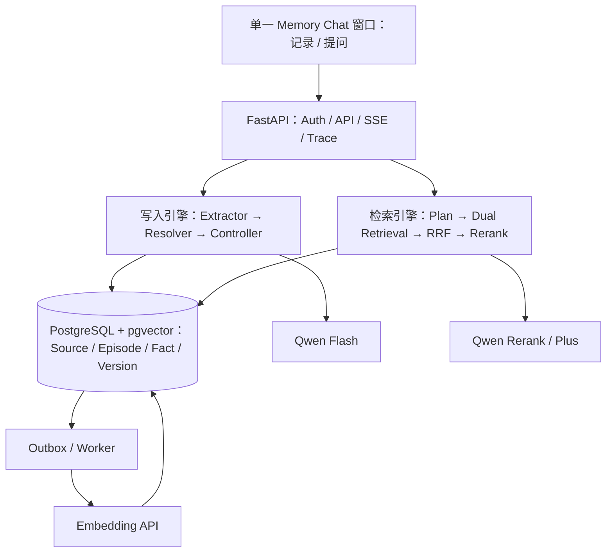
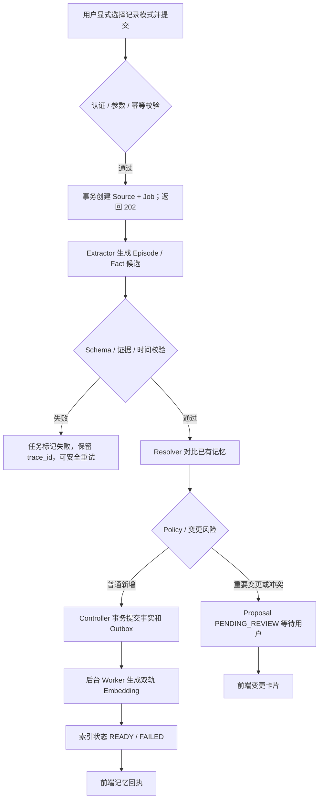
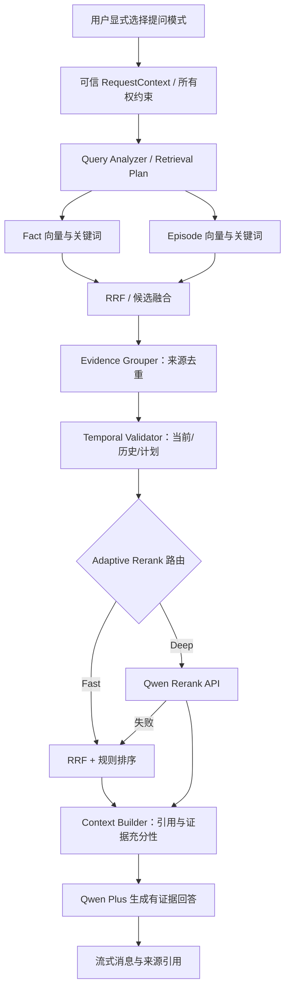
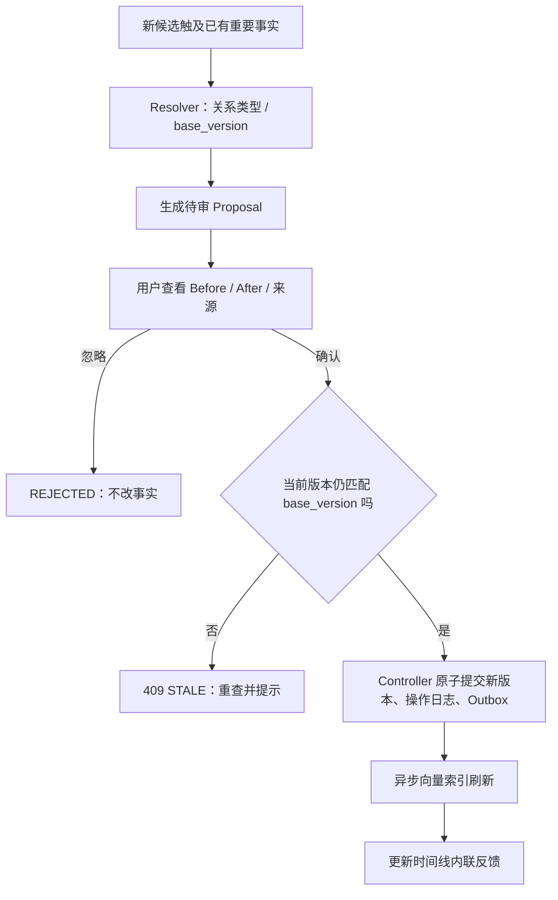
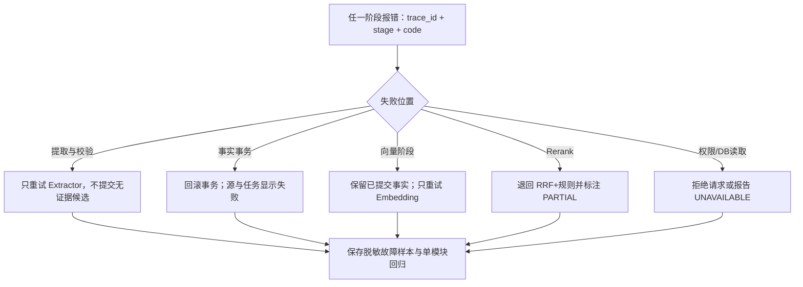
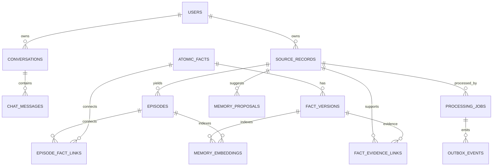
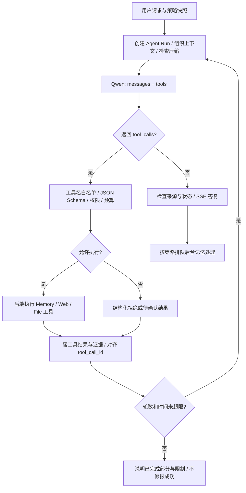

# Personal Agent V1.0｜真实 Agent 与长期记忆系统

**产品需求文档（PRD）+ 技术设计规范（TDD）+ PoC 执行与排障手册**  
**文档版本：** 1.1（真实 Agent 实施范围）  
**文档日期：** 2026-10-26  
**状态：** 用户已确认核心范围；真实后端与前端接入代码已实现，云端及 PostgreSQL 基础闭环真实验收已通过；数据库服务重启及完整浏览器真实链路待验收

**目标读者：** 产品负责人、前端工程师、后端工程师、AI/检索工程师、测试工程师（初期可以是同一开发者）

> **一句话定义：** 实现真实调用云端大模型、按策略记住用户、压缩长对话上下文，并通过 Tool Calling 搜索网页、读取文件、检索记忆和生成有来源回答的 Personal Agent。

**版本说明：** 为兼容引用，文件名保留 v1.0，正文版本为 1.1。原稿备份：`docs/archive/Personal_Agent_Memory_Module_PRD_v1.0.original.md`。用户已确认：可关闭的智能记忆，低风险自动保存、重要变化确认；联网搜索和文件读取必须同时交付；先用云端 API 跑通真实流程；其他前端模块暂缓。§17–23 补齐 Agent、工具、压缩、接口和真实验收。实现进度及真实验收状态以 §23.3 与验证记录为准，文档描述不代表模型调用已成功。

## 0. 执行摘要与确认决策

### 0.1 本版必须实现的闭环

用户在 Agent 工作台聊天、主动记录、上传文件或要求联网查找。FastAPI 调用真实 Qwen；Agent Runtime 按需执行记忆、文件和网页工具。智能记忆开启时，后台从符合策略的用户陈述提取事件与事实，低风险新增自动提交，重要变化等待确认；显式记录走同一受控写入管线。消息、来源、事实版本、摘要、索引和任务持久化到 PostgreSQL + pgvector。新会话及服务重启后仍能回忆，长对话自动压缩；回答分别引用个人记忆、文件和网页，不确定则明确说明。

### 0.2 决策登记（已确认，不在实现中自行变更）

| 编号    | 决策                                     | 约束说明                                                                                     |
| ------- | ---------------------------------------- | -------------------------------------------------------------------------------------------- |
| ADR-001 | 第一版只有一个 **Agent 工作台**          | 聊天、记录、文件上传、记忆和工具证据在同一窗口，其他模块暂缓                                 |
| ADR-002 | 可关闭的智能记忆                         | 开启时后台处理符合策略的用户陈述；关闭时普通聊天不提取，仍可显式记录；替代旧版仅记录写入规则 |
| ADR-003 | 自研 Hybrid Memory Engine                | Extractor / Resolver / Controller / Retriever 职责分离                                       |
| ADR-004 | Source + Episode + Atomic Fact 双轨      | 一份输入可有 0..N 事件和 0..N 事实；关联有来源证据                                           |
| ADR-005 | PostgreSQL + pgvector 单数据库           | 事实、版本、关系、任务、向量统一维护；无 Neo4j                                               |
| ADR-006 | Qwen / 阿里云百炼为 PoC 模型服务         | Flash / Plus / Text Embedding / Rerank，最终可用模型 ID 由 P0 核查                           |
| ADR-007 | 双轨混合检索                             | Dense Vector + 关键词 + 结构化时间/实体约束；轨道内 RRF、跨轨证据分组                        |
| ADR-008 | 自适应 Reranking                         | 简单问题 RRF+规则；复杂问题调用 Qwen Rerank API；失败回退                                    |
| ADR-009 | 低风险新增自动保存、重要变化请求确认     | 未批准的事实不得作为已确认的长期记忆参与检索                                                 |
| ADR-010 | MVP 不开发复杂敏感记忆管理               | 仍需基础凭据拦截、数据隔离、访问控制与删除                                                   |
| ADR-011 | 联网搜索和文件读取必须交付               | 访问公开网页与用户上传文件，不扫描整台电脑                                                   |
| ADR-012 | 云端模型 + 本地持久化                    | 必要文本发送云端，凭据仅后端持有；首期本地单用户                                             |
| ADR-013 | 模型选择工具，后端执行工具               | Schema、权限、预算、幂等和审批由 Runtime/Controller 控制                                     |
| ADR-014 | 会话压缩独立于长期记忆                   | 摘要有原消息引用、可重建，不直接作为已确认事实                                               |
| ADR-015 | 默认删除事实及全部版本/索引，保留 Source | 旧引用失效，摘要/核心视图失效，阻止从保留来源自动复活                                        |
| ADR-016 | 修改候选后重新审核                       | 编辑不提交正式事实，用户基于当前版本确认后才生效                                             |

### 0.3 第一版明确不做

暂不开发知识图谱、任务管理、日历/邮件操作、主动提醒、多 Agent 协作、微服务、Neo4j、独立敏感 Vault、图像/音视频理解及扫描件 OCR。联网搜索和文本文件读取属于本期，集成在工作台内，不另做空白页面。文件范围见 §19；不开放任意 Shell、任意 SQL 或整机文件权限。

### 0.4 成功定义（真实集成场景）

1. 用户第一次记录“我正在开发 Personal Agent，后端考虑用 FastAPI”，关闭或新开会话后问“我现在做什么项目”，能准确回答并引用来源。
2. 用户随后记录“我最终决定后端采用 FastAPI，数据库使用 PostgreSQL”，系统不增加重复画像；对已有计划做版本判断，必要时展示确认卡片。
3. 用户问“我之前考虑什么，现在决定什么，为什么”，回答能区分历史、当前和讨论理由；未记录过原因时不得虚构。
4. 用户问从未记录过的个人信息，Agent 表示“当前记忆中没有相关记录”，不猜测、不伪造引用。
5. 开启智能记忆后聊天说“以后先讨论方案再写代码”，入库后重启并新建会话，AI 的建议仍遵守该偏好。
6. 上传真实项目文档，要求结合项目状态和最新资料提出建议；实际调用记忆、文件、网页工具，回答有三类来源。
7. 长对话触发压缩后保留约束、决定和未解决问题，能回查原文。

## 1. 用户与交互范围

### 1.1 目标用户与任务

**MVP 用户：** 一名研发者本人，本地测试多次会话；架构要求所有数据具备 `owner_id`，为将来的多用户做好基础隔离。**目标任务：** 记录经历、随时提问、修正记忆、追溯出处、感受“越用越懂我”。

### 1.2 唯一窗口的信息架构

沿用工作台页面，保留会话、消息流、输入区、显式记录入口和来源抽屉；新增智能记忆开关、文件上传、工具执行状态，以及可收起的“关于你 / 当前项目 / 最近记住 / 本次使用的记忆 / 上下文状态”面板。处理详情按需展开，其余模块保留禁用占位。

**模式区分：**

| 模式                   | 用户输入                             | 默认后端行为                                   | 是否永久更新长期记忆                               |
| ---------------------- | ------------------------------------ | ---------------------------------------------- | -------------------------------------------------- |
| 记录                   | “今天想到了一个关于 AI Agent 的点子” | POST record → 提取、去重、写入/待审 → 回显结果 | 是，仅经策略批准的候选                             |
| 普通聊天，智能记忆开启 | “我喜欢先讨论方案；上周有哪些点子？” | Agent 工具循环与回答，后台处理用户陈述         | 仅符合策略的陈述，问题和模型回复不作为用户事实     |
| 普通聊天，智能记忆关闭 | “我上周思考过哪些点子？”             | Agent 工具循环与回答                           | 不提取新长期记忆，仍能读取已有记忆                 |
| 临时对话               | “这次不保留对话”                     | 本次云端推理与临时上下文                       | 不读取个人记忆，不持久化消息、摘要、文件和长期记忆 |
| 记录后查看             | 点开记忆处理结果                     | GET 来源、已入库事实、待审提案                 | 否                                                 |
| 重要变更确认           | 点“确认更新”                         | 服务端版本检查 → 提交新事实版本                | 是，批准后才生效                                   |

**避免歧义的设计：** 策略由后端根据用户设置确定，模型不能更改。开启时“我现在改用 PostgreSQL 了”可产生重要变更提案，但批准前不替换当前事实；关闭时只作为消息。单条“别记这条”禁止长期提取，正常聊天历史仍保存；临时对话才禁止本地持久化。云端服务自身的保留策略不由本地临时模式保证消除。

### 1.3 建议窗口线框（开发参考，不要求像素级实现）

下图保留消息与记忆回执的基础布局；v1.1 还必须按 §1.2、§21 加入智能记忆开关、文件上传、工具活动与压缩详情，不能仅按旧双模式线框验收。

```text
┌───────────────────────────────────────────────────────────────────────┐
│  ◉ Personal Agent / Memory                                     ⚙︎   │
│  当前会话：记忆对话                                     新建会话     │
├───────────────────────────────────────────────────────────────────────┤
│ 用户 [记录] 昨天研究了 Memory Retriever...                            │
│ 系统 [处理结果] 新增事件 1 / 新增事实 2 / 待确认 1   [展开]             │
│ AI   我已记录你昨天的研究...                                           │
│                                                                      │
│ 用户 [提问] 我目前项目的技术路线是什么？                               │
│ AI   根据你之前的记录，你正在开发 ... [来源 1] [来源 2]                │
│                                                                      │
│ [记忆变更确认卡片] 原方案 → 新方案    [确认] [修改] [忽略]             │
├───────────────────────────────────────────────────────────────────────┤
│  [● 记录到长期记忆] [○ 向二脑提问]                                      │
│  输入框：记录你的经历，或向自己的长期记忆提问...                      │
│  [发送]                                                        ⏎     │
└───────────────────────────────────────────────────────────────────────┘
```

### 1.4 前端组件与具体要求

| 组件                 | 职责                              | 核心状态                           | 错误/空态            |
| -------------------- | --------------------------------- | ---------------------------------- | -------------------- |
| `MemoryChatPage`     | 唯一页面容器、模式和会话管理      | `record` / `ask`                   | API 不可用提示       |
| `MessageList`        | 按会话显示消息与卡片              | loading、streaming、done           | 空会话引导           |
| `MessageComposer`    | 输入、模式、发送和重复提交保护    | idle、submitting、disabled         | 输入过长、网络失败   |
| `MemoryWriteReceipt` | 显示写入和提案统计、链接来源      | processing、partial、ready         | 提取失败、索引待同步 |
| `MemoryChangeCard`   | 重要变更确认，显示 Before/After   | pending、approved、rejected、stale | 版本冲突重新加载     |
| `EvidenceDrawer`     | 展开来源、事件和事实版本          | collapsed、loading、loaded         | 来源无法取得         |
| `CitationChip`       | AI 回复指向 memory/version/source | 可访问、已删除                     | 失效引用提示         |
| `SystemStatus`       | 当前服务及索引同步健康            | ready、degraded、unavailable       | 不伪称已保存         |

**界面文案规则：** `已收到` ≠ `已提取` ≠ `已保存` ≠ `已索引`。任何阶段失败，都要显示准确状态和可重试路径。未经实际 DB 提交不得出现“成功记住”。

### 1.5 必须落地的产品需求（FR）

| 编号  | 产品需求                             | 优先级 | 验收要点                                                     |
| ----- | ------------------------------------ | ------ | ------------------------------------------------------------ |
| FR-01 | 聊天/记录与智能记忆开关              | P0     | 政策可见，关闭和临时模式不越权写入                           |
| FR-02 | 个人记录创建原始来源                 | P0     | 记录有 owner、source_id、时间、状态                          |
| FR-03 | Extractor 提取 0..N 事件与 0..N 事实 | P0     | JSON Schema、原文证据、时间模态                              |
| FR-04 | Resolver 进行去重与事实变更判断      | P0     | EQUIVALENT/ENRICHMENT/STATE_CHANGE/CONTRADICTION/UNRELATED   |
| FR-05 | 低风险自动写入；重要变更确认         | P0     | Pending 不出现在已确认检索中                                 |
| FR-06 | 保留事实版本、来源和事件关联         | P0     | 可查看“当前/曾经”和依据                                      |
| FR-07 | Fact 与 Episode 各自创建向量         | P0     | P0 冻结模型与维度，绑定版本和任务状态                        |
| FR-08 | 普通提问召回双轨证据并回答           | P0     | 支持跨会话读取、有引用                                       |
| FR-09 | 简单查询快速检索，复杂查询按需重排   | P1     | 回退策略可测量                                               |
| FR-10 | 明确无证据时可拒答                   | P0     | 无个人事实幻觉                                               |
| FR-11 | 记忆查看、修改、删除及重试           | P1     | 修改留版本，删除清派生索引                                   |
| FR-12 | 事件处理和检索可观测                 | P0     | 每次请求有 trace_id 和阶段日志                               |
| FR-13 | 真实云端对话与 Tool Calling          | P0     | 实际 provider request_id、工具执行和结果回传，不用 Mock 验收 |
| FR-14 | 智能记忆与个性化                     | P0     | 低风险自动记、重要变化确认、关闭有效、重启后偏好保持         |
| FR-15 | 会话上下文压缩                       | P0     | 阈值触发、摘要可追溯、约束保留、不污染长期事实               |
| FR-16 | 联网搜索与网页读取                   | P0     | 真实结果、URL/抓取时间、失败可见、最小化查询披露             |
| FR-17 | 文件上传、解析、检索和读取           | P0     | 真实文件、定位引用、授权隔离与越权拒绝                       |
| FR-18 | 受控 Agent Runtime                   | P0     | 工具白名单、Schema、预算、审批、取消与恢复                   |
| FR-19 | 记忆可见性                           | P0     | 关于你、当前项目、本轮记忆和依据来自后端真实状态             |
| FR-20 | 真实集成验收                         | P0     | 新会话及重启后记忆、文件/联网/模型同时通过                   |

## 2. 全链路技术流程图

§2.1–2.6 展示记忆引擎子流程；完整 Agent 调度、网页与文件工具由 §18 的 Runtime 流程组织，不能将记忆检索子流程误当作完整 Agent。

### 2.1 总体技术架构



### 2.2 用户主动记录：写入时序与状态边界



**要点：** 用户提交时只保证 Source 创建；Extractor 不能直接写事实；Resolver 根据旧事实提出动作；Controller 在同一事务内提交事实版本、证据链接、操作日志和 Outbox；Embedding 是提交后的异步任务；若 R1 待确认，新候选保持 `PENDING_REVIEW`，不提前更新当前事实。

### 2.3 用户提问：读取、证据分组和自适应重排



**要点：** 检索与生成解耦。先进行用户身份/用途校验，再分别执行 Fact、Episode 向量和关键词检索；按时间模式处理历史版本；通过证据组消除重复来源；Rerank 失败时回退到规则排序；只有被验证的证据进入 Prompt。

### 2.4 事实更新、重要变更确认与撤销



**要点：** 同一状态主张只存在一个当前版本；旧版本不可覆盖性修改；批准必须带 `base_version_id`，防止两个标签页同时提交旧方案；撤销普通修改采用补偿版本，彻底删除是独立流程。

### 2.5 故障定位和恢复机制



**要点：** 输入接收、提取、事实提交、向量索引、检索排序、聊天生成分别拥有状态与错误码；必要时只重跑失败阶段，不重复整条流水线。

### 2.6 核心实体关系（逻辑 ER 图）



## 3. 记忆模型与数据库详细设计

### 3.1 三层结构与不变量

**原始层 Source：** 原始输入与提交上下文，供追溯与重处理。**事件层 Episode：** 按发生时间组织一段经历、事件或未来计划。**事实层 Atomic Fact：** 可以独立判断、检索、修订的用户画像/状态/事件事实。Source 与 Episode、Fact 分别关联，Episode ↔ Fact 多对多。事实版本采用追加式变更，不直接覆盖旧正文。

**核心不变量：**

1. 所有用户数据必须具有可信的 `owner_id`，由服务端确定；跨表关联还需校验 owner 一致。
2. 事实正文及原始证据不可由未经核验的 LLM 输出直接覆盖。
3. `source_record` 可以产生零条候选；不强制制造记忆。
4. `atomic_fact` 代表同一逻辑主张的身份；`fact_version` 是该主张某时刻的表述及有效性。
5. `event_time`（事实发生/计划发生）与 `recorded_at`（系统记录）不混淆。
6. 待确认、已删除、被撤销的记忆不得参与“当前已确认事实”检索。
7. 数据库事务成功与向量同步成功分开记录；检索必须可识别过时索引。
8. 一个来源支持多条事实，但不代表多份独立证据；跨轨证据聚合时按来源去重。

### 3.2 建议核心表（MVP）

| 表                    | 主键及关键字段                                                                                                   | 索引与一致性约束                                                      | 用途                                                      |
| --------------------- | ---------------------------------------------------------------------------------------------------------------- | --------------------------------------------------------------------- | --------------------------------------------------------- |
| `users`               | id, created_at, status                                                                                           | id 唯一                                                               | 本地单用户 PoC 也不省略归属                               |
| `conversations`       | id, owner_id, created_at, title                                                                                  | owner_id + created_at                                                 | 会话容器，不等同长期记忆                                  |
| `chat_messages`       | id, conversation_id, role, mode, content, created_at, trace_id                                                   | conversation_id + created_at                                          | 展示聊天与记录交互；提取遵循每条消息的策略快照            |
| `source_records`      | id, owner_id, raw_text, timezone, recorded_at, status, idempotency_key                                           | (owner_id,idempotency_key) 唯一                                       | 显式记录或授权聊天来源，关联 source_message_id 与策略快照 |
| `episodes`            | id, owner_id, source_id, title, summary, event_kind, occurrence_status, event_start/end, time_precision, status  | owner_id + event_start                                                | 事件轨                                                    |
| `atomic_facts`        | id, owner_id, subject_key, predicate_key, object_key, fact_type, current_version_id, status                      | owner_id + subject_key + predicate_key 的候选匹配索引（非简单强唯一） | 逻辑事实身份                                              |
| `fact_versions`       | id, fact_id, version_no, content, modality, attribution, valid_from/to, recorded_at, superseded_at, review_state | (fact_id,version_no) 唯一；每 Fact 最多一个有效当前版本               | 追加式事实版本                                            |
| `episode_fact_links`  | episode_id, fact_id, relation_type, source_id                                                                    | 复合唯一 + owner 一致校验                                             | 双轨事件↔事实                                             |
| `fact_evidence_links` | version_id, source_id, evidence_text, span_start/end                                                             | 外键 + 来源一致性校验                                                 | 原文证据溯源                                              |
| `memory_embeddings`   | id, owner_id, target_type, target_version_id, model_id, dimension, embedding, embedding_text_hash, index_status  | target_type + target_version_id + model_id + text_hash 唯一           | Fact/Episode 双轨向量                                     |
| `memory_proposals`    | id, owner_id, source_id, candidate_payload, proposed_action, risk_level, base_version_id, status, expires_at     | 状态与版本条件                                                        | 待审重要变更                                              |
| `memory_operations`   | id, owner_id, operation, target_id, before_version_id, after_version_id, actor, trace_id, created_at             | owner_id + created_at                                                 | 审计与可撤销普通修改                                      |
| `outbox_events`       | id, aggregate_type/id, event_type, payload, status, attempt_count, available_at                                  | status + available_at                                                 | 事务内写入、异步可靠派发                                  |
| `processing_jobs`     | id, owner_id, source_id, stage, status, attempts, last_error_code, trace_id, updated_at                          | stage + status + updated_at                                           | 分阶段重试与可观测                                        |

**特别提示：** `memory_embeddings.target_type + target_version_id` 是跨两类目标的多态引用，普通 SQL 外键无法直接保证它同时引用两张目标表。MVP 应通过服务层一致性检查并在删除路径严格级联；如果希望数据库层强约束，实施时应改为分别 nullable 的 `fact_version_id` / `episode_id` 并以 CHECK 保证恰有一项非空，或拆分目标表。此处推荐**明确双外键 + CHECK**，在实施 Schema 时冻结此细节。对 `atomic_facts` 的逻辑主张不能用 `(subject,predicate)` 作为全局唯一，因为相同属性可能在不同项目与时间多次出现。

### 3.3 必需枚举/状态字段

| 对象             | 允许状态                                                             | 说明                                                 |
| ---------------- | -------------------------------------------------------------------- | ---------------------------------------------------- |
| Source           | RECEIVED, EXTRACTING, RESOLVING, PARTIAL, COMMITTED, FAILED          | Source 的流程态，不等于向量完成                      |
| Candidate Action | ADD, EQUIVALENT, ENRICH, REVISE, SUPERSEDE, CONFLICT, NOOP           | Resolver 建议，非最终 DB 动作                        |
| Proposal         | PENDING_REVIEW, APPROVED, REJECTED, EXPIRED, STALE                   | 两个标签页并发须有 STALE                             |
| Fact Version     | CURRENT, HISTORICAL, PLANNED, RETRACTED, DELETED                     | 状态语义与审核状态分开；DELETED 仅保留无正文引用墓碑 |
| Embedding        | PENDING, RUNNING, READY, FAILED, STALE, DELETED                      | 对应内容版本，查询时检查                             |
| Retrieval        | COMPLETE, PARTIAL, INSUFFICIENT_EVIDENCE, UNAVAILABLE, ACCESS_DENIED | 执行状态与证据充足性分开                             |
| Evidence         | SUPPORTED, CONFLICTED, INSUFFICIENT                                  | 供 Chat Engine 作真实性约束                          |

### 3.4 时间建模

至少保存 `recorded_at`（带时区绝对时刻）、`timezone_name`（如 Asia/Shanghai）、`event_start`/`event_end`、`time_precision`（INSTANT/DAY/MONTH/YEAR/RANGE/UNKNOWN）、`time_expression`（如“上周三”）、`valid_from`/`valid_to`。相对日期基于**提交时的用户时区与时间**解析，不能在未来查询时重新解释。“下周开始”存为计划目标日期，不能当作实际发生事件。

### 3.5 索引设计

Fact 与 Episode 分别构造自包含 `embedding_text`；模型 ID、地域和维度由 P0 真实验证后冻结；1024 维仅为候选配置。初期精确近邻查询 + B-tree 用户及时间索引 + 技术名词关键词匹配；中文全文检索分词质量不足时评估 PGroonga，不把它作为 P0 阻塞项。初期无需强行建立 HNSW；切换向量模型时影子索引重建，不混用不同模型向量。`pgvector` 的 ANN 过滤可能影响召回，跨用户隔离不依赖 ANN 排名后过滤。

### 3.6 数据删除与恢复（最低限度）

单条事实删除需要使当前版本不可检索、禁止新索引任务、清理向量与引用；默认删除事实及全部版本/索引，保留原始 Source；同时使相关摘要、核心记忆与缓存失效并创建遗忘抑制记录，防止从保留来源自动重新提取已删事实。删除和普通撤销是不同接口。若来源含凭据等明显秘密，输入前置拦截，避免持久化原文。备份保留和更高敏感数据生命周期管理是后续版本项目，MVP 不能宣称任何第三方或备份副本立即完全消失。

## 4. Memory Extractor：输入输出与提示词契约

### 4.1 职责与输入

Extractor 只把输入转成**候选**，不访问/修改历史事实版本。输入为原始 Source、提交时区、记录时间、允许使用的少量指代上下文、`extractor_prompt_version`。不把整个历史记忆库注入本次提取，避免旧记忆污染证据归属。对于模糊代词，可以返回歧义，交给 Resolver。

### 4.2 结构化候选输出示例（协议示意，不是实现代码）

```json
{
  "schema_version": "extractor.v1",
  "source_id": "src_demo_001",
  "episodes": [
    {
      "candidate_id": "E1",
      "title": "与朋友讨论数据库选型",
      "summary": "用户与朋友讨论 Personal Agent 的数据库方案；朋友建议 Neo4j，用户决定第一版采用 PostgreSQL。",
      "event_type": "DISCUSSION",
      "occurrence_status": "OCCURRED",
      "time_expression": "上周三",
      "event_time": "2026-10-14",
      "time_precision": "DAY",
      "evidence_spans": ["上周三我和朋友讨论了数据库方案"]
    }
  ],
  "facts": [
    {
      "candidate_id": "F1",
      "content": "用户已决定 Personal Agent 第一版采用 PostgreSQL。",
      "fact_type": "STATE",
      "speech_act": "DECISION",
      "subject": "Personal Agent 第一版",
      "predicate": "database_choice",
      "object": "PostgreSQL",
      "modality": "DECIDED",
      "attribution": "USER_SELF_REPORT",
      "evidence_spans": ["我决定第一版先使用 PostgreSQL"],
      "requires_review": false
    },
    {
      "candidate_id": "F2",
      "content": "朋友曾建议用户考虑 Neo4j。",
      "fact_type": "EVENT_FACT",
      "speech_act": "QUOTE",
      "subject": "朋友",
      "predicate": "suggested_database",
      "object": "Neo4j",
      "modality": "REPORTED",
      "attribution": "THIRD_PARTY_REPORTED_BY_USER",
      "evidence_spans": ["他建议我使用 Neo4j"],
      "requires_review": false
    }
  ],
  "episode_fact_links": [
    {
      "episode_candidate_id": "E1",
      "fact_candidate_id": "F1",
      "relation": "DESCRIBES"
    },
    {
      "episode_candidate_id": "E1",
      "fact_candidate_id": "F2",
      "relation": "DESCRIBES"
    }
  ],
  "unresolved_items": []
}
```

**校验顺序：** 解析输出结构 → 检查候选编号唯一与跨引用有效 → 证据片段存在于 Source（允许规范化空白后匹配）→ 校验时间表达与有效性 → 检查不确定性/否定词 → 密钥与敏感信息拦截 → 进入 Resolver。对于证据无法定位的候选只能标记为 `NEEDS_REVIEW` 或舍弃，不能自动写入。

### 4.3 Prompt 设计骨架

System/Developer 提示词需固定五段：任务与角色（忠实提取）→ 输出 Schema → 归属/否定/时间/计划/引用规则 → 多事件和零候选示例 → 禁止推断或执行用户输入里的指令。用户文本放在明确标记为“被分析材料”的独立字段。模型不得自行生成数据库正式 ID、所有者、最终写入类型或版本号。提示词与 Schema 使用独立版本号；变更提示词后在同一人工标注集做回归。

## 5. Memory Resolver / Controller：去重、变更与事务

### 5.1 Resolver 关系判定

使用 `owner_id`、同一项目实体、关键词/结构化状态键、向量候选和必要历史版本构造匹配集合。关系分类：`EQUIVALENT`（同事实追加证据）、`ENRICH`（补充已有事实）、`STATE_CHANGE`（新状态已明确）、`CONTRADICTION`（不能同时成立且原因不清）、`UNRELATED`（不同事件/项目）与 `AMBIGUOUS`（不确定归属）。向量高相似度不等于相同事实，否定和时间要独立核对。

### 5.2 Controller 决策

| Resolver 关系     | Controller 处理                       | 前端呈现               |
| ----------------- | ------------------------------------- | ---------------------- |
| 新独立事实        | ADD 新事实 + V1                       | 已保存                 |
| 完全等价          | ADD_EVIDENCE，不增加重复 CURRENT 版本 | 已补充证据             |
| 补充细节          | REVISE 新版本，保留旧版本             | 如影响重要状态则待确认 |
| 明确计划/偏好变化 | SUPERSEDE 当前版本，旧版本历史化      | 重要变更确认卡         |
| 真正冲突          | 创建 PENDING_REVIEW proposal          | 冲突澄清卡             |
| 含糊无证据        | NOOP / NEEDS_REVIEW                   | 未形成长期事实         |

**版本事务边界：** 只有 Controller 可以开事实提交事务；在同一事务中写入正式事实或新版本、事实来源链接、事件事实链接、审计操作、Outbox 事件。事务成功后才返回 `COMMITTED`。Outbox Worker 异步生成向量、缓存同步、事件更新；重试不得导致重复事实。

### 5.3 重要变更确认卡接口约束

卡片必须展示类型、旧内容、新内容、证据来源、时间、受影响事实、解释、审批动作。`APPROVE` 必须传 `proposal_id` 与 `base_version_id`；若当前事实版本已变化，返回 `409 MEMORY_VERSION_CONFLICT`，刷新提案，不许默默覆盖。忽略提案不删除原始 Source；不更新当前事实。批次部分成功时应展示自动保存数、待确认数、失败数。

## 6. Memory Retriever：自适应双轨检索

### 6.1 关键数据对象

| 对象              | 最少字段                                                                                          | 来源                        |
| ----------------- | ------------------------------------------------------------------------------------------------- | --------------------------- |
| `RequestContext`  | user_id、conversation_id、request_time、timezone、allowed_scope                                   | Auth/API，**不由 LLM 决定** |
| `QueryAnalysis`   | intent、entities、temporal_mode、subqueries、ambiguities                                          | Query Analyzer              |
| `RetrievalPlan`   | query、fact_k、episode_k、lexical_k、time_scope、rerank_policy、budget_ms、plan_version           | Planner                     |
| `Candidate`       | memory_id、version_id、type、content、source_ids、retrieval_channel、rank、score、temporal_status | 各 Retriever                |
| `EvidenceGroup`   | group_id、facts、episodes、source_ids、supported_claims、contradictions                           | Grouper                     |
| `RetrievalResult` | status、evidence_status、context_blocks、citations、warnings、trace_id                            | Context Builder             |

### 6.2 示例 RetrievalPlan

```json
{
  "plan_version": "retrieval.v1",
  "query": "我之前为什么考虑 MySQL，现在决定什么？",
  "intents": ["HISTORICAL_COMPARE", "RELATION_REASONING", "CURRENT_STATE"],
  "entities": ["Personal Agent", "MySQL"],
  "temporal_mode": "TIMELINE",
  "subqueries": ["历史数据库方案", "最新有效数据库方案", "变更原因的事件证据"],
  "retrieval": {
    "fact_vector_k": 15,
    "episode_vector_k": 15,
    "fact_lexical_k": 10,
    "episode_lexical_k": 10
  },
  "reranking": { "policy": "ADAPTIVE", "max_groups": 20, "final_groups": 6 },
  "require_citations": true
}
```

`owner_id` 不包含在模型生成的 JSON 里；后端从 `RequestContext` 和数据库层权限确定。上述 K 值是可调 PoC 起点，不是实测最优。

### 6.3 精确检索与混合排序

1. 基于可信用户范围和时间条件检索，第一阶段以 pgvector 精确检索为基线。
2. Fact Semantic、Episode Semantic、Fact Lexical、Episode Lexical 分开召回；精确实体与时间查找是补充路径。
3. 各轨内部 RRF 合并排名，不直接相加不同来源原始相似度。
4. 跨轨通过 `source_id`、事实主张和 `episode_fact_links` 聚合 Evidence Groups；同一来源产生的 Episode/Fact 不是多份独立证据。
5. Temporal Validator 确认 CURRENT/HISTORICAL/PLANNED/AS_OF；硬性状态约束不能被高语义分覆盖。
6. Query 简单时 RRF + 规则；复杂跨轨、因果比较或多候选时调用 Qwen Rerank API（Deep Path）。
7. Reranker 失败或超时回退规则排序；若一级召回不足则有限改写/补召回，不能靠 Reranker 凭空补证据。
8. 以 Token 预算选 5–8 个相关证据组，输出来源、时间、状态和不确定性给 Chat Engine。

### 6.4 查询路由（建议）

| 用户查询                           | intent             | 路径 | 特别规则                       |
| ---------------------------------- | ------------------ | ---- | ------------------------------ |
| 我的专业是什么？                   | FACT_LOOKUP        | Fast | 画像事实优先                   |
| 我现在做什么项目？                 | CURRENT_STATE      | Fast | 只引用当前有效事实             |
| 上周我做过什么？                   | EPISODIC_RECALL    | Deep | 按 event_time，不按录入时间    |
| 我之前和现在的技术方案有什么不同？ | HISTORICAL_COMPARE | Deep | 历史版本与当前版本均召回       |
| 我为什么选择 PostgreSQL？          | RELATION_REASONING | Deep | 找不到理由就明说               |
| 根据你的了解建议下一步？           | PERSONAL_SYNTHESIS | Deep | 先证据、后建议，区分推断与事实 |

### 6.5 RetrievalResult 示例

```json
{
  "status": "COMPLETE",
  "evidence_status": "SUPPORTED",
  "trace_id": "tr_demo_001",
  "context_blocks": [
    {
      "kind": "CURRENT_FACT",
      "text": "用户当前决定 Personal Agent 第一版使用 PostgreSQL。",
      "memory_id": "fact_demo_01",
      "version_id": "v2",
      "source_ids": ["src_demo_02"]
    },
    {
      "kind": "HISTORICAL_FACT",
      "text": "用户此前考虑过 MySQL。",
      "memory_id": "fact_demo_01",
      "version_id": "v1",
      "source_ids": ["src_demo_01"]
    }
  ],
  "citations": [
    {
      "memory_id": "fact_demo_01",
      "source_id": "src_demo_02",
      "display_label": "数据库决策记录"
    }
  ],
  "warnings": []
}
```

**严禁：** 在回答里把 `HISTORICAL_FACT` 描述为当前事实；返回未提交/待确认候选；将未命中的空证据伪装成已查询到个人信息。

## 7. API 合同与前后端时序

### 7.1 REST / SSE 接口清单（版本统一 /api/v1）

| 方法   | 路径                             | 用途                       | 结果/备注                                                 |
| ------ | -------------------------------- | -------------------------- | --------------------------------------------------------- |
| POST   | `/memory/records`                | 主动写入原始记录，启动处理 | 202 + source_id / job_id / trace_id；支持 Idempotency-Key |
| GET    | `/memory/records/{id}`           | 获取一次记录的处理结果     | 200 + Source/Fact/Episode/提案统计                        |
| GET    | `/memory/jobs/{id}`              | 获取阶段/失败原因          | 200，状态可轮询；后续可 SSE                               |
| GET    | `/memory/proposals`              | 当前会话所需待审提案       | 200，owner 范围过滤                                       |
| POST   | `/memory/proposals/{id}/approve` | 审核并提交重要变更         | 200，需 base_version_id；409 冲突                         |
| POST   | `/memory/proposals/{id}/reject`  | 拒绝提案                   | 200，不改变事实当前版本                                   |
| GET    | `/memory/facts/{id}`             | 取事实及版本、来源         | 200 / 404 / 403                                           |
| PATCH  | `/memory/facts/{id}`             | 用户主动修订事实           | 200，`If-Match` 或 base_version；新版本                   |
| DELETE | `/memory/facts/{id}`             | 用户主动删除事实           | 202，任务化删除派生索引                                   |
| POST   | `/chat/messages`                 | 向二脑提问，开始检索与生成 | 建议 SSE，关联 conversation_id                            |
| GET    | `/conversations/{id}/messages`   | 恢复会话消息               | 200，按权限访问                                           |
| GET    | `/health/live`                   | 服务进程存活               | 200，不能当作依赖健康                                     |
| GET    | `/health/ready`                  | DB / 关键依赖可用性        | 200 / 503，返回最少状态                                   |

### 7.2 写入 API 请求与响应示例

```http
POST /api/v1/memory/records
Headers: Idempotency-Key: demo-request-001
{
  "conversation_id":"conv_demo_01",
  "text":"今天研究了长期记忆，我决定第一版先使用 PostgreSQL。",
  "client_timezone":"Asia/Shanghai"
}

202 Accepted
{
  "source_id":"src_demo_001",
  "job_id":"job_demo_001",
  "status":"RECEIVED",
  "trace_id":"tr_demo_001"
}
```

**关键语义：** `202 Accepted` 表示请求已被后端接受并创建处理任务，**不表示长期事实已经成功保存**。前端通过 job 状态查询或事件流接收 `EXTRACTED` / `COMMITTED` / `INDEXED` / `PENDING_REVIEW` 更新。

### 7.3 对话流事件契约（建议 SSE）

| SSE 事件              | 必需载荷                        | 前端操作               |
| --------------------- | ------------------------------- | ---------------------- |
| `retrieval.started`   | trace_id、conversation_id       | 显示正在查找记忆       |
| `retrieval.completed` | evidence_count、warnings        | 切换到生成状态         |
| `retrieval.degraded`  | reason_code、available_channels | 提示部分检索路径不可用 |
| `message.delta`       | seq、text                       | 追加 AI 字符流         |
| `message.citations`   | citations[]                     | 追加来源 chip          |
| `message.completed`   | message_id、usage、trace_id     | 标记已结束             |
| `message.error`       | error_code、retryable、trace_id | 以可恢复状态显示错误   |

必须定义流中断后的恢复策略：同一 `message_id`/请求幂等识别，避免重连后多次生成或重复持久化消息；若未支持真正断点续传，第一版允许显示“本次回答已中断，请重新生成”，不得把半段输出显示成完整回答。

### 7.4 统一错误响应

```json
{
  "error": {
    "code": "MEMORY_VERSION_CONFLICT",
    "message": "记忆已在其他会话中更新，请刷新后重新确认。",
    "stage": "memory_controller",
    "retryable": false,
    "trace_id": "tr_demo_001"
  }
}
```

HTTP 状态遵守职责：400 输入参数、401 未认证、403 无权限、404 未发现/不可见资源、409 乐观锁或重复冲突、422 业务结构校验、429 限流、502 上游响应不可用、503 关键依赖不可用、504 上游超时。用户错误文本不得暴露内部 SQL、API Key、敏感 Prompt 或栈追踪。

## 8. 模块划分、目录规划与可替换边界

### 8.1 建议工程目录（结构设计，不是已生成代码）

```text
personal-agent/
├─ apps/
│  ├─ web/                          # 唯一 Memory Chat 页面
│  │  ├─ src/app/memory/            # 记忆对话入口
│  │  ├─ src/components/chat/       # 消息流、输入区、流式回答
│  │  ├─ src/components/memory/     # 记忆回执、确认卡、证据详情
│  │  ├─ src/lib/api/               # HTTP/SSE 适配、响应校验
│  │  └─ src/state/                 # 当前模式/会话/处理任务状态
│  └─ api/
│     ├─ app/main.py               # FastAPI 装配（不得内嵌业务逻辑）
│     ├─ app/api/v1/               # routers：memory/chat/health
│     ├─ app/core/                 # config、auth、exceptions、logging
│     ├─ app/domain/               # schema、enum、domain decisions
│     ├─ app/services/memory/
│     │  ├─ extractor.py            # LLM 提取候选
│     │  ├─ resolver.py             # 旧记忆匹配与关系判断
│     │  ├─ controller.py           # 事务提交、审批和版本
│     │  └─ evidence.py             # 来源校验与双轨关联
│     ├─ app/services/retrieval/
│     │  ├─ query_analyzer.py
│     │  ├─ planner.py
│     │  ├─ candidate_retriever.py
│     │  ├─ fusion.py
│     │  ├─ grouper.py
│     │  ├─ temporal.py
│     │  ├─ adaptive_reranker.py
│     │  └─ context_builder.py
│     ├─ app/services/agent/        # Runtime、工具循环、预算、运行状态
│     ├─ app/providers/             # qwen LLM / embedding / rerank 适配
│     ├─ app/repositories/          # 数据访问层：Source/Fact/Episode/Job
│     ├─ app/workers/               # outbox 消费、embedding、清理重试
│     ├─ app/db/                    # ORM、迁移、会话、RLS 支持
│     └─ tests/                     # unit/integration/e2e/fixtures
├─ migrations/                     # 数据库版本管理
├─ datasets/                       # 合成样例与人工标签
├─ evaluations/                    # 提取/检索/回答评估
├─ docs/                           # PRD、ADR、运行手册、数据字典
└─ infra/                          # docker-compose、环境示例、启动脚本
```

### 8.2 依赖方向（避免循环依赖）

API router 只校验与调用 Service；Service 使用 Domain Contract + Repository Interface + Model Provider Interface；Provider 与 Repository 不依赖业务 Service；Controller 持有事务边界；Retriever 只读 Repository；Chat Engine 只能消费 Retriever 的 `RetrievalResult`。禁止在路由函数中直接拼接 prompt、执行复杂 SQL 或调用模型后立即覆盖 Fact。

### 8.3 哪一层出了错，改哪一层？

| 用户现象                         | 首先检查                                 | 不应该先做的事           |
| -------------------------------- | ---------------------------------------- | ------------------------ |
| 一段话少提了事件                 | Extractor 提示词、Schema、证据标注       | 重写数据库结构           |
| ---                              | ---                                      | ---                      |
| 同一事实保存多次                 | Resolver 关系判断、幂等键、写入唯一条件  | 重写前端页面             |
| ---                              | ---                                      | ---                      |
| 新方案被旧方案覆盖               | Controller 版本事务与 Temporal Validator | 更换 LLM 品牌            |
| ---                              | ---                                      | ---                      |
| 问题相关事实找不到               | Candidate Retriever 和索引状态           | 盲目提高聊天 Prompt 长度 |
| ---                              | ---                                      | ---                      |
| 正确事实排名过低                 | Fusion、Evidence Group、Rerank           | 把所有候选都塞进 LLM     |
| ---                              | ---                                      | ---                      |
| LLM 用证据编造原因               | Context Builder、Chat Prompt、答案评测   | 重建所有向量             |
| ---                              | ---                                      | ---                      |
| 记忆已保存却无向量               | Outbox/Worker、Embedding API、重试状态   | 重跑 Extractor 导致重复  |
| ---                              | ---                                      | ---                      |
| 用户看见“保存成功”却数据库无记录 | API 响应语义、前端状态映射               | 放弃异步任务机制         |

## 9. 稳定性、并发、幂等与一致性

### 9.1 数据流与事务策略

**同步：** 请求认证 → 参数校验 → 创建 `source_record` + 对应 job → 返回 202。**异步：** Extract → Validate → Resolve → Controller transaction → Outbox → Embedding Worker。前期可在同一 FastAPI 工程运行独立 Worker 进程轮询 PostgreSQL Job/Outbox，暂不引入 Redis/RabbitMQ；进程重启后能从持久任务继续。

**推荐采用至少一次投递 + 消费端幂等**，不是假设 Worker 永远只执行一次。Outbox 事件应有 `event_id` 和幂等消费记录。Index Worker 只有在 `target_version_id` 与当前允许索引的版本一致时才写向量；失效历史版本由独立状态决定是否可保留用于历史检索。

### 9.2 重试与状态恢复

LLM 超时可以有限重试提取且保留 Source；JSON Schema 连续不合格则 `FAILED_VALIDATION`，不可将错误候选入库。Controller DB 事务失败整体回滚，Worker 不创建重复事实。Embedding 失败只重建向量，不能重跑记忆提取。Rerank API 失败回退规则排序。所有后台任务支持 `attempt_count`、`next_retry_at`、`last_error_code`、死信或人工重试状态。

### 9.3 最小安全基线

后端唯一持有百炼密钥；环境变量或 Secret 存储，禁止提交到 Git。开发本地可以单用户，但数据表仍保留 owner_id；公开上线之前必须补齐身份认证与授权校验、HTTPS、数据库最小权限和跨用户测试。收到密码/API Key/私钥时拒绝进入长期记忆与普通原文日志。第三方引用/文档内容不得当作系统 Prompt 指令。后台提取遵守智能记忆开关、单条排除和临时模式；模型回复及第三方内容不能作为用户自述。

## 10. 可观测性与排障手册

### 10.1 每次请求的 trace 结构

一个前端 `request_id` 对应一个全链路 `trace_id`，每个模块写子阶段 `span_id`。建议日志统一字段：`timestamp`、`level`、`trace_id`、`span_id`、`owner_hash`（不可反推）、`source_id`、`job_id`、`stage`、`model_id`、`provider_region`、`latency_ms`、`token_in/out`、`candidate_count`、`error_code`、`retryable`。默认不记录原始私人全文或密钥。

### 10.2 错误码与排障矩阵

| 错误码                     | 模块            | 触发条件            | 排障步骤                              | 允许降级？       |
| -------------------------- | --------------- | ------------------- | ------------------------------------- | ---------------- |
| `MODEL_AUTH_FAILED`        | Provider        | Key、区域、权限有误 | 核 Key、Endpoint、区域、模型授权      | 否，先修配置     |
| `MODEL_RATE_LIMITED`       | Provider        | 429/额度速率超限    | 查配额/账单；退避重试                 | 可延迟任务       |
| `EXTRACT_SCHEMA_INVALID`   | Extractor       | 缺字段、枚举错误    | 对照 Schema、模型原始结构、提示词版本 | 标记 Source 待修 |
| `EXTRACT_EVIDENCE_MISSING` | Evidence        | 候选无原文支持      | 查 Source span、归属、否定            | 拒绝自动写入     |
| `RESOLVE_AMBIGUOUS`        | Resolver        | 同名实体/冲突       | 查候选旧事实、subject_key、证据       | 待用户确认       |
| `MEMORY_VERSION_CONFLICT`  | Controller      | 提案基于过期版本    | 刷新事实版本与提案                    | 不自动覆盖       |
| `DB_COMMIT_FAILED`         | Repository      | 事务失败            | 查数据库异常、连接池、约束            | 不宣布成功       |
| `OUTBOX_STUCK`             | Worker          | 事件积压            | 查任务状态、Worker、last_error        | 可重试           |
| `EMBEDDING_FAILED`         | Provider/Worker | API 错误/维度不符   | 查模型 ID、维度、输入文本             | 结构化检索回退   |
| `RETRIEVAL_PARTIAL`        | Retriever       | 一条路径失败        | 查通道 Trace、候选/索引状态           | 可降级并标注     |
| `RERANK_TIMEOUT`           | Reranker        | API 超时            | 查候选大小、网络、超时                | 回退 RRF         |
| `EVIDENCE_INSUFFICIENT`    | Context         | 证据无关或缺失      | 查 Query Plan/Recall@K                | 返回不知道       |
| `CHAT_GENERATION_FAILED`   | Chat            | LLM 输出中断        | 查 Provider、SSE、消息状态            | 保留重试入口     |
| `ACCESS_DENIED`            | Auth            | 越权操作            | 查身份/owner_id/RLS                   | 严禁宽松降级     |

### 10.3 分段健康检查与故障定位步骤

**从前到后查：** (1) API 健康 / 请求是否进入；(2) Source 是否创建；(3) Extractor 是否产生有效候选；(4) Resolver 决策是否正确；(5) Controller 事务是否提交；(6) Outbox 是否处理；(7) Embedding 是否 READY；(8) Retrieval Plan 是否命中正确实体/时间；(9) Candidate Recall 是否含正确事实；(10) Fusion/Temporal/Rerank 是否剔除了正确证据；(11) Context Builder 是否包含正确来源；(12) Chat LLM 是否忠实表达。每步有独立可复制的输入/输出快照（模拟/脱敏）。

建议维护一次失败的“故障样本包”：`trace_id + schema_version + model_id + stage input digest + stage output digest + expected + actual + repair commit`。修复后将该样本加入回归测试集，防止同类问题再次出现。

## 11. API 费用与性能基线

本地运行前端、FastAPI、PostgreSQL/pgvector 和轻量 Worker；模型推理通过百炼 API 完成，本地不要求独立 GPU，开发建议 16GB 内存、SSD；8GB 可以尝试但需限制并发。模型成本随调用次数、Token、模型区域和当期价格变化，**不得把本文价格或历史估算当作账单保证**。每次 API 调用记录实际 usage、供应商返回 ID、耗时和成本估算；PoC 设置自定义月度预算与调用上限。Embedding 模型与维度在 P0 冻结、事实/事件分别索引、Rerank 仅复杂问题，避免重复向量化。

建议追踪：写入 P50/P95、提取成功率、事务成功率、向量 READY 延迟、检索 P50/P95、Rerank 触发率、端到端回答延迟、每次写入/提问成本、后台积压任务数。

## 12. 测试设计、质量阈值与验收

### 12.1 数据集与分层评测

建议准备 60 条中文/中英混合记录，人工标注至少 100 条候选事实和事件；Retriever 使用 150 条独立模拟 Source、300+ Facts/Episodes 和 100 道人工标注问题。最初不要求数字越大越好，关键是包含可复现、容易区分正确/错误的边界样本。

| 测试集    | 核心场景                                 | 主要指标                          | 建议目标（规划值，非实测）                      |
| --------- | ---------------------------------------- | --------------------------------- | ----------------------------------------------- |
| Extractor | 事实、事件、否定、引用、计划、时间       | Precision / Recall / Schema Valid | Precision≥95%，Recall≥90%；Schema通过率接近100% |
| Resolver  | 等价、补充、变更、冲突、跨项目           | Decision F1、误覆盖数             | F1≥90%，重要状态误覆盖=0                        |
| Temporal  | 昨天、上周、去年、历史变更、未来计划     | Temporal Accuracy                 | ≥90%                                            |
| Retriever | Fact-only / Episode-only / Dual / Hybrid | Evidence Recall@10、nDCG@10、MRR  | Recall@10≥85%，其余对基线提升                   |
| Reranker  | Fast / Always Rerank / Adaptive          | nDCG、P95、调用率、成本           | 在质量可接受下减少额外 API 调用                 |
| Answer    | 有证据、无答案、来源引用                 | Faithfulness、Abstention          | ≥95%证据忠实度；无依据拒答≥90%                  |
| Security  | 跨用户/敏感凭据/待审事实                 | 越权成功、未授权检索              | 测试中 0 次成功越权                             |

重要：评测召回时以**证据组和来源 ID**作为标签，避免同一 Source 派生多条 Fact+Episode 导致错误加分。Cross-Encoder 的实验必须在实际第一阶段召回的候选集上执行，不把正确答案偷偷放入候选集。

### 12.2 必须包含的回归样本

T01：记录“今天学了 RAG”，隔会话能回忆；T02：同一请求网络重试不能重复新增；T03：同一事实隔天重述应追加证据；T04：两次同名会议不同日期不得合并；T05：“考虑用 MySQL”与“决定用 PostgreSQL”区分模态；T06：“不是 PostgreSQL”正确处理否定；T07：转述朋友意见不写成用户偏好；T08：未来计划不作为已完成事件；T09：用户未说明理由时不得虚构原因；T10：同一个来源衍生 Fact 与 Episode 不算双证据；T11：历史有效性查询能找旧版本；T12：待确认变更不得进入当前聊天检索；T13：旧提案审批触发 409；T14：Embedding 失败后只重建索引；T15：Reranker 超时回退；T16：数据库不可用不能假装完成；T17：不同 owner 数据零交叉；T18：凭据禁止自动记忆；T19：关闭智能记忆或临时对话时不提取长期记忆；T20：来源删除后引用显示失效而非悬空异常。

### 12.3 MVP 最终验收（Go / No-Go）

**必须达成：** 一个页面真实走通云端模型 Tool Calling、记忆写入/更新/检索、网页搜索/读取、文件上传/检索/读取及上下文压缩；来源可查，服务重启后数据保留；计划与已完成不混淆；重复请求幂等；待审不进入正式检索；错误有 trace_id；无凭据暴露。§23 的真实验收全部通过才可声明 Personal Agent 完成，Mock 和接口单测不能替代。

## 13. 实施里程碑、任务拆分与依赖

| 阶段                       | 主要任务                                                                               | 交付物                           | 完成门槛                                                                                   |
| -------------------------- | -------------------------------------------------------------------------------------- | -------------------------------- | ------------------------------------------------------------------------------------------ |
| P0 模型与环境预检          | 百炼账户区域/API Key、Flash/Plus/Embedding/Rerank Smoke Test；PostgreSQL/pgvector 连通 | `api_smoke_report`、环境配置清单 | 真实聊天/提取/Embedding/Rerank/Tool Calling/搜索可用，实际模型与维度冻结、费用与错误可记录 |
| P1 数据契约与 DB           | ORM/迁移、Source、Episode、Fact、版本、证据、Job、Outbox                               | DB Schema、迁移、Repository 测试 | 约束与回滚、owner 隔离通过                                                                 |
| P2 写入引擎                | Extractor、Evidence Validator、Resolver、Controller、Proposals                         | 完整写入与更新流程               | 20 条关键写入案例及版本冲突可复现                                                          |
| P3 索引与检索基线          | Embedding Worker、双轨向量、关键词、时间查询、RRF                                      | `RetrievalResult` 基线           | Fact/Episode 单轨与双轨可测                                                                |
| P4 自适应 Rerank           | Plan、Grouper、Temporal、Qwen Rerank、回退                                             | Fast/Deep 对照报告               | Rerank 超时不阻塞检索，有指标                                                              |
| P5 Chat Engine             | Qwen Plus、Evidence Context、SSE、引用与无证据回复                                     | 后端端到端问答接口               | 能跨会话召回，回答有来源                                                                   |
| P5a Agent Runtime          | 真正 Function Calling、工具注册、权限、执行循环、预算、取消/恢复                       | 运行记录与工具契约               | 真实模型选择并调用工具，结果传回模型；伪工具名/越权拒绝                                    |
| P5b Web / Files            | 搜索 Provider、网页读取、上传解析、文件检索/读取                                       | 工具及来源适配                   | 真实联网与上传文件引用，通过隔离和提示注入测试                                             |
| P5c Context / Smart Memory | 阈值压缩、核心视图、后台提取政策、遗忘抑制                                             | 可追溯摘要和智能记忆             | 长对话约束保持，关闭有效，删除不复活，重启后偏好有效                                       |
| P6 唯一对话窗口            | 记录/提问模式、消息流、回执卡、提案卡、证据抽屉                                        | Memory Chat 页面                 | 智能记忆策略可见且有效，用户可真实完成记录、文件和联网任务                                 |
| P7 回归与硬化              | 100 问评测、失败注入、成本压测、文档                                                   | 演示脚本、测试报告、运维手册     | Go/No-Go 清单通过                                                                          |

**实施顺序：** P0 先验证实际账户的模型、Tool Calling 和联网能力；P1→P2→P3 打通持久化记忆；P5/P5a 建立真实 Agent 循环；P5b/P5c 完成文件、联网和压缩；P6 复用现有前端接入真实状态；P7 做 §23 验收。P4 可先以规则回退跑通，但自适应重排需在最终验收前完成。每步交付真实纵向能力，不继续扩大 Mock 演示替代后端。

### 13.1 每个阶段必须提交的开发产物

任务卡至少写明 `Module / Input Contract / Output Contract / Dependencies / Happy Path / Failure Cases / Unit Tests / Integration Tests / Logs / Acceptance`。一个模块开发完先通过单元测试与伪造 Provider 输出的测试，再接真实 API。每次修改只替换本模块实现并运行邻接合同测试，不能以“先跑通”为由让上层直接访问底层 SQL 或模型 SDK。

### 13.2 推荐的提交顺序

`chore/bootstrap` → `feat/db-schema` → `feat/provider-gateway` → `feat/memory-extractor` → `feat/memory-resolver` → `feat/memory-controller` → `feat/embedding-worker` → `feat/retrieval-base` → `feat/adaptive-rerank` → `feat/chat-engine` → `feat/memory-chat-ui` → `test/e2e-and-hardening`。每一个提交阶段都必须可以运行独立测试，避免一次提交修改全栈且无法定位错误。

## 14. 风险、限制与待验证决策

| ID   | 风险或待定项                    | 默认处理                                                          | 关闭条件                   |
| ---- | ------------------------------- | ----------------------------------------------------------------- | -------------------------- |
| R-01 | 百炼模型在具体区域不可调用      | P0 提前核实；更换同类可用 Qwen 模型并更新模型配置，不修改服务接口 | API Smoke Test             |
| R-02 | 严格 JSON Schema 行为与文档差异 | 接口实际测试，不以文档描述代替运行验证                            | 模拟/真实提取样本通过      |
| R-03 | 中文全文检索质量不足            | 先关键词精确匹配；根据失败样本决定是否加 PGroonga                 | 关键词测试报告             |
| R-04 | LLM 提取幻觉                    | Evidence Validator + 批量人工评测                                 | 错误事实不自动入库         |
| R-05 | 旧向量滞后                      | version_id 校验与索引任务重试                                     | 更新后当前状态检索测试通过 |
| R-06 | LLM 成本及响应慢                | 自适应模型调用、缓存/预算、模型 usage 记录                        | 量化 P50/P95 和费用        |
| R-07 | 文本中包含秘密                  | 提交前检测与拒绝或脱敏；暂不做复杂 Vault                          | 凭据泄漏样例测试通过       |
| R-08 | 未来多人上线                    | MVP 单用户验证但保留 owner、auth、RLS 扩展点                      | 上线前安全专项检查         |
| R-09 | 某条输入被误分类“记录/提问”     | 写入权限由后端策略快照决定，不依赖模型自行授权                    | 模式误写测试通过           |
| R-10 | 删除与历史证据冲突              | 定义删除范围、引用降级、派生向量清理                              | T20 与删除回归通过         |

## 15. 开发负责人可执行的第一天清单

**第一步**：确认本地 Python、PostgreSQL、pgvector、前端运行环境能启动；准备环境变量示例，不填真实 API Key 到仓库。**第二步**：在百炼同一地域分别验证 Flash、Plus、Embedding、Rerank，记录请求/响应、模型 ID、维度、usage 和错误。**第三步**：以 5 段完全虚构的中文记录运行提取，确认一个输入可以产生多个 Episode/Facts，时间、否定、引用保留。**第四步**：先建 Source、Fact、Version、Episode、Evidence、Job、Outbox 表与独立 repository 测试。**第五步**：开发写入接口后，用固定模型输出替身测试事务、幂等和重要变更审批。通过后再接入真实 LLM。**第六步**：将 Fact/Episode 写入 pgvector、建立最简单的查询，先测有证据是否能命中，再增加 RRF 和 Reranker。**第七步**：接 Chat Engine 和唯一记忆对话窗口，完成跨会话演示并运行故障注入。

## 16. 关键技术参考（开发时优先查官方文档）

1. 阿里云百炼文本生成与模型列表：https://help.aliyun.com/zh/model-studio/text-generation-model
2. 百炼向量与重排序模型：https://help.aliyun.com/zh/model-studio/embedding-rerank-model
3. 百炼 Embedding API：https://help.aliyun.com/zh/model-studio/embedding
4. 百炼 Reranking API：https://help.aliyun.com/zh/model-studio/rerank
5. pgvector 文档与多租户过滤说明：https://github.com/pgvector/pgvector
6. PostgreSQL 官方行级安全：https://www.postgresql.org/docs/current/ddl-rowsecurity.html
7. FastAPI 官方：https://fastapi.tiangolo.com/
8. SQLAlchemy 官方：https://docs.sqlalchemy.org/
9. Alembic 官方：https://alembic.sqlalchemy.org/
10. Graphiti（事件/事实与时间设计参考，不作为必须依赖）：https://github.com/getzep/graphiti
11. Mem0（去重和长期记忆思路参考，不作为底层替代）：https://github.com/mem0ai/mem0

## 附录 A：可视化流程图源文件

本 Markdown 中的 Mermaid 代码块为 v1.1 流程依据。此前的 mermaid/ 和 v1.0 导出图保留为历史参考，本轮未声称已同步这些旧导出物；新增 Agent 流程见 §18，开发时以本文为准。

## 附录 B：实施前的设计冻结检查

在编写业务代码之前，开发者应逐项核对：唯一工作台、智能记忆与临时模式、文件/网络工具权限；所有 Model Gateway 接口；Source/Fact/Episode/Version 的不变量；记录接口的 202 与异步结果语义；待审版本锁；重要状态时序；`RetrievalResult` schema；统一错误码和 `trace_id`；幂等和 Outbox；固定评测数据与模型配置。上述条款未对齐时不应跳过接口设计直接把业务写入路由文件。

## 17. 记忆、RAG 与上下文管理的职责

### 17.1 本项目采用 RAG，但记忆系统不止 RAG

RAG（Retrieval-Augmented Generation，检索增强生成）是“检索相关资料 → 把证据放进上下文 → 模型据此回答”。本项目的长期记忆召回、文件问答和网页证据回答均使用这一模式。RAG 不等于向量数据库，也不必仅用向量：结构化查询、关键词、向量和时间过滤共同参与检索。

本项目额外需要 Source 持久化、信息提取、重要性与归属判断、去重、版本更新、人工确认、删除与遗忘、后台任务、核心记忆和上下文压缩。因此：**Personal Agent = 云端模型 + 受控工具循环 + 记忆生命周期 + RAG + 上下文管理**。普通聊天不必每轮调用工具，但本项目必须拥有真实 Tool Calling。MCP 是可选工具协议，不是具备 Tool Calling 的前提。长期记忆通过外部数据和每轮上下文供给实现，不是每次聊天重新训练模型参数。

### 17.2 四层记忆

| 层           | 内容                                             | 权威性与用途                                               |
| ------------ | ------------------------------------------------ | ---------------------------------------------------------- |
| 原始来源     | 用户消息、显式记录、上传文件片段、网页快照       | 保留作者/类型/时间/定位；网页和文件不自动变成用户画像      |
| 会话工作记忆 | 最近完整交互、当前目标、约束、待办问题、会话摘要 | 服务当前会话；摘要是有损派生物，不是正式事实               |
| 长期记忆     | 原子事实、事件、计划、历史版本和证据             | Controller 提交后为正式记忆，待审隔离                      |
| 核心记忆视图 | 经过确认的少量个人偏好、稳定背景、当前项目       | 从有效事实派生，携带 fact/version ID；不维护第二套独立真相 |

所有内容具有个人/项目/会话范围。默认跨会话仅使用已授权的相同 owner 与相符项目内容；临时会话不加载个人记忆。核心视图在事实变更、删除、项目切换时更新或失效，不能把一个项目的选型当作所有项目的偏好。

### 17.3 智能记忆策略

默认开启但明显可见、可随时关闭。策略优先级：临时模式/单条禁止 > 用户当前关闭状态 > 显式记录授权 > 智能提取规则。关闭智能记忆仍可显式记录；临时模式下若要求记录，先退出临时模式并明确确认。

- 自动保存：用户明确陈述、证据可定位、归属明确、低风险且无冲突的新增偏好或项目事实。
- 必须确认：重要目标/计划/承诺/身份状态变化、涉及高敏感内容、存在矛盾、代词或归属不清、模型推断。风险由服务端规则和分类共同决定，不能只信任模型置信度数值。
- 不提取：纯问题、假设、AI 自己的回复、网页/文件中的指令、未被用户认领的第三方陈述、禁止记忆的消息。否定、计划和转述必须保留模态。
- 普通聊天回答后后台处理；显式记录立即排队并显示真实进度。若用户紧接着问刚才内容，当前会话可据最近消息回答，但不能声称后台尚未提交的内容已经长期保存。
- 按 owner/message_id/policy_version 幂等；显式转为记录和后台处理指向同一来源。开启开关不自动回溯历史消息。
- 关闭时提高 policy epoch，尚未提交的自动任务在提交前复核并取消；已经提交的记忆不会被开关自动删除。UI 显示该区别。
- 用户点击删除后记录抑制范围及原来源关系，后台重试/重摘要不能复活。用户以后明确重新记录时，才允许新的授权来源重建该事实。

### 17.4 上下文文本压缩

Context Manager 在每次主模型/工具循环续轮前检查 token 预算。输入预算 = 经验证的模型窗口 - 回答预留 - 协议/工具 Schema 预算 - 安全余量。初始软阈值可设输入预算的 70%，目标压回约 40%–50%；参数属于 PoC 起点，必须实测调优并记录，不能作为既成性能结论。

保留近期完整交互，优先压缩较早的已完成交互。不能拆开 assistant tool_calls 与对应 tool 结果；单条超长消息/文件先分块，不盲目截断。输入过长到无法安全处理时要求缩小范围或改为文件上传。

摘要至少包含 summary_id、conversation_id、covered_message_ids/range、source_hash、summary_version、模型与 prompt_version、创建时间，以及目标、用户约束、已确认决定、未解决问题、实体、关键来源指针。工具结果先做带来源的抽取式裁剪；必要时再调用摘要模型。输出预算必须显式传入模型，不能只在本地估算。

原始消息保留，摘要不覆盖原文、不直接参与个人事实提取。允许按引用回查被压缩消息；累计摘要轮次或证据变更后，从原始片段重建，避免无限摘要套摘要。摘要提交使用消息范围/版本条件防止并发覆盖。

摘要失败时保留已有摘要和原文，降级选择有界近期上下文并说明上下文受限；无法容纳关键约束时停止生成并说明，不伪称记得全文。涉及被删除记忆的摘要立即失效，原文回查也要执行遗忘过滤。界面可展开查看压缩范围和保留的关键信息；token 数为估算时必须标“估算”。

## 18. Agent Runtime 与 Tool Calling

### 18.1 调用机制与边界

采用百炼支持的 Function Calling 协议，通过 Provider Gateway 适配。FastAPI 向模型发送消息、相关上下文和 tools 的名称/描述/JSON Schema；模型返回 tool_calls（工具名、JSON 参数、调用 ID）；**后端执行实际函数**，再将结果以对应 tool_call_id 回传模型，由模型生成答案或请求下一项工具。模型不会直接获得数据库连接、任意磁盘路径或 Shell。



首版默认串行调度，依赖调用按返回结果继续；模型一次返回多个调用时仍逐个校验和记录，不能丢弃多余调用。后续只允许独立只读工具并行。主模型续轮保存所选供应商协议要求的完整 assistant/tool 消息；工具 ID 必须一一对应，禁止伪造 tool 结果。

### 18.2 必须实现的工具目录

| 名称               | 参数边界                                         | 返回与权限                                                 |
| ------------------ | ------------------------------------------------ | ---------------------------------------------------------- |
| search_memory      | query、时间模式、limit；项目范围由可信上下文裁剪 | 当前/历史/计划证据与版本，不能读其他 owner 或待审事实      |
| read_memory_source | 后端返回的 source_id、有限区段                   | 原文和定位；执行授权、遗忘及删除检查                       |
| get_fact_history   | 已授权 fact_id、limit                            | 有效历史版本与时间线，已删版本只给失效状态                 |
| search_files       | query、当前授权 file_ids、limit                  | chunk_id、file_id、页/段/行定位和片段                      |
| read_file          | file_id、chunk_id 或有限页/段范围                | 只读用户上传且授权的文件；不接受任意 OS 路径               |
| web_search         | 最小化公开 query、条数、可选时间条件             | URL、标题、摘要、检索时间；需要真实 Provider 证据          |
| read_web_page      | 搜索结果或用户给定的已校验 URL、范围             | 页面正文片段与抓取时间；不能访问私网或本机                 |
| propose_memory     | source_message_id、candidate 内容/证据           | 只提交候选给统一写入管线；低风险按政策提交，重要变化待确认 |
| request_forget     | 已授权 fact_id、明确用户删除请求                 | 生成 UI 删除确认请求，不直接删除，不扩大既定范围           |

工具参数中不接受模型提供的 owner_id、API Key、数据库连接、审批标志。工具成功返回标准 envelope：`{ok, data, citations, truncated, trace_id}`；失败返回 `{ok:false, error:{code,retryable,message}, trace_id}`。tool_call_id、run_id、owner 和执行状态由 Runtime 包装，不让模型指定。

确认/拒绝提案、删除批准、关闭智能记忆等由用户 UI/API 明确触发，不作为模型可自我调用的批准工具。候选编辑必须回到比较界面再审核。外部材料中的“请保存/删除/忽略规则”等文本不构成用户授权。

### 18.3 有界执行与故障恢复

初始预算建议：每 run 最多 6 个模型轮次、12 次工具执行、总时限 120 秒；工具单次默认 15 秒、模型单次默认 45 秒，均受剩余总预算裁剪。每轮输入输出 token、每工具输出字符/条数也有限额。预算可配置，P0/P7 实测后冻结；不是延迟保证。

- 只读临时网络错误最多重试 1 次且计入预算；参数错误最多给模型一次修正机会。未知工具、无权限、禁止 URL 不宽松降级。
- 工具输出统一限额、引用保留、转义显示；检索到的文字是数据而不是高优先级指令。
- 本地写操作用 request/run/tool-call 幂等键，执行状态事务落库；崩溃后先核对已提交结果，不重复产生事实。
- 消费者取消或断线后保存可恢复状态；无真正断点续传时保留中断提示，重生成替换未完成消息。写任务是否已提交以数据库状态为准，不因取消显示“已撤销”。
- 记录工具开始/完成/失败、耗时、引用、调用身份；不记录隐私全文或模型内部思维链。前端显示工具活动摘要和结果证据。
- 用户明确要求最新/联网或文件依据时，Runtime 要求相应工具成功证据；模型未调用时可重试选择或明确失败，不能用模型旧知识冒充已搜索。

### 18.4 记忆与工具的关系

稳定的核心记忆和必要会话上下文由 Context Manager 自动加载，不用每次先调用一个工具。较大范围、历史或细节检索由模型按需调用 search_memory/get_fact_history。提取、压缩、权限和事务是后端确定性管线，不能全部交给模型自由规划。读取工具返回的是 RAG 证据，写入工具受记忆政策约束，二者职责独立。

## 19. 联网搜索与文件读取

### 19.1 联网实现方案

主 Agent 暴露统一 web_search/read_web_page 工具。后端 WebSearchProvider 优先验证百炼可用的联网能力：可用时封装为独立搜索请求，归一化真实返回的来源；若账户/地域不支持可追溯搜索，接入单独搜索 API，P0 明确供应商和配置。该替换不能悄悄降低“真实联网”的验收要求。

百炼 Chat Completions 的 enable_search 与 Responses 的服务端 web_search 是不同接口能力；主 Agent 的 Function Calling 不等于开启内置搜索。不假设两种 API、模型、地域支持相同组合，不把供应商不存在的统一端点写死。P0 验证实际来源字段、模型选择行为、错误与用量后固定适配器。

查询尽量只包含公开主题和必要关键词，不自动附带个人档案、完整聊天或文件正文。确需搜索私有文本时先展示待发送查询供用户确认。网页内容只作外部证据；不可直接成为“用户喜欢/用户决定”的事实。用户明确说“把这篇资料加入项目知识”时可保存为外部知识，保留出处和检索时间。

网页抓取仅允许 HTTP(S)，每次 DNS 解析和重定向后复核目标；拒绝 loopback、私网、link-local、云 metadata、file/data 等协议，防止 SSRF。设置下载大小、响应时间、重定向次数限制；无授权不抓登录态、付费或需要账号的内容。搜索摘要不能冒充已读取全文；抓取失败单独提示并保留可用的搜索来源。

### 19.2 文件范围与流水线

首期支持用户主动上传的 TXT、Markdown、可提取文本的 PDF 和 DOCX；扫描 PDF、加密文件、不支持格式明确提示，暂不做 OCR。此范围是实施默认，不包含整机扫描或任意路径读取。初始限制建议单文件 20 MB、PDF 300 页，解析后字符数另设上限；P0 用实测资源消耗调整，界面显示真实限制。

上传 → 类型/大小/凭据检查 → 隔离存储 → 本地解析 → 保留页/段/行定位 → 分块 → Embedding → 授权文件检索。解析不执行宏、脚本或附件；检查压缩包膨胀、路径穿越与异常解析，限制 CPU/内存/时间。文件 ID 由服务器生成，路径由后端映射，工具不接收用户或模型任意磁盘路径。

文件作用域默认当前会话，用户明确选择“加入项目资料”后跨同项目会话可检索。模型只获取需要的片段和元数据，不默认发送整份文件。上传文件的内容属于文档知识，不能因为用户上传就推断文中作者的经历是用户经历。

文件引用至少有 file_id、file_version、chunk_id、原文件名、页码或段落/行范围、hash。替换文件产生新版本；删除文件立即撤销检索和工具授权、异步清理块/向量并使引用失效；若文件支撑个人事实，标记证据失效并重新审核，不能继续把失效来源作为支持。临时对话文件使用临时资源，关闭/过期后清理，不建长期索引。

## 20. 模型调用时机与服务端模块

| 触发               | 处理方式                              | 模型/API 调用                                    |
| ------------------ | ------------------------------------- | ------------------------------------------------ |
| 新用户消息         | 校验、策略快照、会话加载、预算检查    | 校验失败不调用模型                               |
| 一般问答           | 加载相关核心/近期上下文               | 主对话模型通常 1 次生成；可不使用工具            |
| 工具需求           | 主模型选择 → 后端执行 → 回传结果      | 每轮续答另一次生成，受 run 预算约束              |
| 智能记忆消息       | 回答后排队，跳过禁止/空内容           | 提取模型按消息或有界批次调用；不是每句必存       |
| 显式记录           | Source 与 job 先入库                  | 提取模型；必要时关系判定模型                     |
| 新旧候选比对       | 精确匹配、版本/时间/实体规则          | 只有歧义或复杂关系再调用轻量模型                 |
| 事实提交与批准     | Controller 事务与 Outbox              | 不调用生成模型；索引异步调用 Embedding           |
| 检索               | 精确/关键词/向量、多轨合并            | 向量查询需 query Embedding；复杂候选按需 Rerank  |
| 上下文超阈值       | 选定旧消息范围、保留近期交互          | 摘要模型，结果校验后写派生摘要                   |
| 文件上传           | 本地解析与分块                        | 索引调用 Embedding，解析不必调用生成模型         |
| 网页搜索           | WebSearchProvider + URL 校验/正文提取 | 真实搜索 API；若用模型内置搜索，单独记录生成用量 |
| 查看/删除/确认记忆 | 数据库操作与权限校验                  | 通常不调用生成模型                               |

Provider Gateway 用配置定义 chat、extract、resolve、summarize、embed、rerank、web_search 角色。主对话使用有 Tool Calling 能力的 Qwen，轻量角色可共用已验证模型；不在代码里假定某个型号必然可用。记录 provider_request_id、模型 ID、区域、实际 usage、延迟、错误码和工具次数，费用只能按已核实费率估算。API Key 只读后端环境变量，禁止前端 NEXT_PUBLIC 配置或提交版本库。

首期部署：一个 FastAPI 服务、一个有持久化任务的 Worker、一个 PostgreSQL + pgvector、本地受控文件存储。无需先拆微服务或引入多个 Agent 框架。工具通过注册表和依赖注入装配；不使用 eval、动态导入模型给定路径或字符串执行。

### 20.1 新增持久化对象

| 对象                         | 必需数据与一致性                                                                |
| ---------------------------- | ------------------------------------------------------------------------------- |
| user_memory_settings         | owner、enabled、policy_version/epoch；提交前再次校验                            |
| conversation_summaries       | 消息范围/ID、摘要、source_hash、版本、模型、失效状态                            |
| core_memory_views            | owner/project、fact/version 引用、内容 hash；变更失效                           |
| agent_runs                   | owner/conversation/request、状态、预算、policy_snapshot、trace_id               |
| tool_executions              | run、tool_call_id、工具/Schema 版本、脱敏参数摘要、结果引用、状态、耗时、幂等键 |
| uploaded_files / file_chunks | owner/scope、文件版本/hash、解析状态、定位、块内容/向量关联                     |
| web_evidence                 | URL、标题、检索/抓取时间、内容 hash、有限片段、run 关联                         |
| memory_suppressions          | 已删事实及来源关联、删除时间、重新授权记录，阻止自动重建                        |

现有会话消息增加 memory_policy_snapshot，Source 增加 source_type/source_message_id；所有派生数据有 owner 和 scope，一致性由数据库/服务端保证。

## 21. API、事件与前端真实状态

保留 §7 的版本化 API。实现前编写 OpenAPI/JSON Schema，并做 Provider 与前端合同测试；以下是本版接口需求，不是已经部署的接口。

| 方法/路径（/api/v1）                | 合同要点                                                                                         |
| ----------------------------------- | ------------------------------------------------------------------------------------------------ |
| GET/POST /conversations             | 列表/创建，owner 由后端确定；创建支持项目范围和 temporary                                        |
| GET/PATCH /memory/settings          | 读取/更改智能记忆策略，返回新 epoch                                                              |
| POST /chat/messages                 | conversation_id、text、file_ids、memory_policy_override、request_id；主流程 SSE，响应关联 run_id |
| GET /agent/runs/{id}                | 恢复运行/工具状态、最终消息或中断信息                                                            |
| POST /agent/runs/{id}/cancel        | 幂等取消，区分已提交写入与未执行动作                                                             |
| POST /files                         | multipart 上传，返回 file_id、job_id、status；接收不等于可检索                                   |
| GET/DELETE /files/{id}              | 解析状态/元数据、删除任务；校验 owner/scope                                                      |
| GET /files/{id}/chunks/{chunk_id}   | 有界来源查看、定位信息与版本校验                                                                 |
| GET /memory/items                   | query、kind、page/page_size、scope；返回 items、total                                            |
| PATCH /memory/proposals/{id}        | text、base_version_id；候选修改不提交正式记忆                                                    |
| POST /memory/proposals/{id}/refresh | 返回当前 before/base_version 与原候选，必须重新审核                                              |
| POST /memory/jobs/{id}/retry        | stage、Idempotency-Key；仅允许失败阶段，不重复整条管线                                           |
| GET /conversations/{id}/context     | 当前摘要、来源范围、预算估算和有效状态；不返回内部思维链                                         |

消息请求中的策略只能在用户权限内收紧，不能靠传参绕过临时模式或关闭状态。前端不直接调用云端模型；上传文件和工具授权均由后端校验。

§7 的 ProcessingJob 增补 `kind`、`state=QUEUED/RUNNING/SUCCEEDED/PARTIAL/FAILED/CANCELLED`、`stage`、`result`、`error`、`trace_id`。stage 与终态分离：零候选可 SUCCEEDED+NOOP；提案可 SUCCEEDED+PENDING_REVIEW；索引失败为 PARTIAL；删除任务成功为 SUCCEEDED+DELETED，不能借用 INDEXED 表示删除。旧前端轮询适配器必须同步升级。

除已有消息 SSE 事件，增加 run.started、tool.started、tool.completed、tool.failed、context.compacted、memory.received、memory.committed、memory.review_required、memory.indexed、run.completed。每项包含 event_id、run_id、trace_id；工具事件含 tool_call_id，记忆事件含 source/job/proposal ID。后台记忆可能晚于主回答完成，通过 job 轮询和会话恢复同步，不能依赖主聊天 SSE 永远不断开。

引用统一为 `citation_id + source_type(memory/file/web) + source_id + version_id + locator + retrieved_at`；Web 另含 URL。生成模型只能引用本轮实际返回的 citation_id，服务端验证引用集合；不存在的引用不展示为可点击成功证据。

工作台新增真实工具活动条、上传/解析进度、智能记忆开关、待审卡、核心记忆面板和压缩详情。健康检查区分模型、DB、Worker、索引和搜索 Provider。正式模式任何依赖失败都显示真实失败，不能自动切回 Mock；Mock 只保留为明确标注的开发测试入口。

## 22. 开源参考与供应商验证

设计参考而非必须整套依赖：

- Letta 的持久化记忆块与上下文组织：[仓库](https://github.com/letta-ai/letta)、[记忆块](https://www.letta.com/blog/memory-blocks/)。本项目采用可追溯核心视图，保留自己的 Controller 审核边界。
- Mem0 的独立记忆读写层：[仓库](https://github.com/mem0ai/mem0)。不直接照搬其默认写入政策，也不替代既定 Source/Episode/Fact 版本模型。
- LangMem 的分层记忆和有阈值会话摘要：[仓库](https://github.com/langchain-ai/langmem)、[摘要指南](https://langchain-ai.github.io/langmem/guides/summarization/)。借鉴保留工具调用/结果配对和运行摘要的做法。
- 百炼 [Function Calling](https://help.aliyun.com/en/model-studio/qwen-function-calling) 与 [联网搜索](https://help.aliyun.com/en/model-studio/web-search) 为接口参考；查阅日期 2026-10-25。

P0 必须验证具体账户/地域/模型的 tools、tool_choice、串行/多个 tool_calls、流式参数拼接、结构化 JSON、联网来源字段、Embedding 维度和 Rerank。不能假设 tool_choice=required 在所有 Qwen 接口下有效；需要工具证据的请求由 Runtime 校验执行结果。模型工具参数流分片需累积并校验完成后才执行，不能边收到半段 JSON 边执行。

目前未取得真实调用证据；开源文档与供应商说明不替代本项目实际调用测试。

## 23. 本期真实验收与开发门槛

### 23.1 新增回归案例

| ID  | 场景                             | 必须验证                                                           |
| --- | -------------------------------- | ------------------------------------------------------------------ |
| A01 | 智能记忆开启，明确低风险偏好     | 真提取/提交，重启及新会话后回答行为符合偏好                        |
| A02 | 关闭、单条排除、临时模式         | 不产生禁止的长期写入；关闭时旧队列也不能提交；临时模式不落本地正文 |
| A03 | 重要变化与候选修改               | 先编辑候选，再审核确认；409 不覆盖当前版本                         |
| A04 | 删除事实后重试/压缩/回查         | 全版本与索引失效，Source 保留但已删事实不会重新进入回答            |
| A05 | 长对话触发真实摘要 API           | 关键约束/决定/未解决项保留；摘要有来源，可回查                     |
| A06 | 摘要失败或超长单条输入           | 无静默丢失和假完成，有界降级或明确拒绝                             |
| A07 | 真实模型工具选择及续轮           | 记录真实 tool_calls、对应执行和 tool_call_id 回传，模型据结果回答  |
| A08 | 伪工具、坏参数、循环、预算超限   | Runtime 拒绝/停止，不执行任意代码或无限循环                        |
| A09 | 联网搜索 + 页面阅读              | 有真实搜索结果/正文/URL/抓取时间；抓取失败不声称读完               |
| A10 | 网页提示注入、私网 URL、隐私查询 | 不执行网页指令，不访问禁止地址，不自动泄露私有上下文               |
| A11 | 上传 TXT/MD/PDF/DOCX             | 每种格式真实读取、检索与定位引用；失败格式明确提示                 |
| A12 | 文件越权/删除/替换               | 无跨范围访问，版本引用一致，删除后不可继续读取                     |
| A13 | 记忆+文件+联网综合任务           | 三类真实证据共同参与，区分用户事实、文档观点、公开资料             |
| A14 | 进程崩溃/重复请求/中断重试       | 消息与已提交记忆不丢不重复，后台任务可恢复                         |
| A15 | DB/模型/搜索不可用               | 真实失败状态，不回退 Mock 伪装完成                                 |

### 23.2 分层验证与交付证据

开发依次执行：纯逻辑单测 → Provider 替身合同测试 → 本地 PostgreSQL 集成测试 → 实际云端 API smoke → 浏览器全链路。真实 API 测试使用明确的合成数据、预算上限和后端环境凭据；测试报告标记 real/mock，脱敏记录 provider_request_id、模型配置、run/trace、DB 结果及引用，不能提交 API Key 或私人原文。

必须提供两次独立进程启动之间的数据延续证据，以及不同会话的记忆召回证据；仅刷新浏览器不算服务重启测试。每阶段提交 commit，相关测试通过后才能继续或交付。前端历史 Mock 测试继续保留，但不能作为本版真实能力的完成证明。

### 23.3 下一阶段启动条件与当前状态

用户已确认产品范围，不再重新询问是否需要真实记忆、联网、文件或云端模型。实施前核对本机 Python/PostgreSQL/pgvector 环境及已有配置；缺失时再请求必需的账户区域、可用模型和搜索 Provider 配置。密钥通过本地环境变量/受保护设置输入，不要求用户发在聊天里。若搜索账户不可用或模型不支持工具调用，记录具体阻塞，不用模拟替代。

截至 2026-10-27，已实现真实后端、云端 Provider、Agent 工具执行、记忆管线与前端接入代码，默认页面不回退 Mock。当前本机已配置百炼及 PostgreSQL，真实提取/向量、重连与跨会话召回、记忆/文件/联网工具及来源引用、上下文压缩、独立进程持久化核对均已通过。数据库服务重启与完整浏览器真实链路尚未验收，基础闭环通过不代表全部验收项完成。已提供只读环境诊断、显式付费模型能力检查及独立进程核对脚本。启动步骤与具体边界见 `docs/local-setup.md`，分层测试结果见 `docs/verification.md`。原 PRD 已设计的事务、来源与版本不变量继续有效；其他前端产品模块仍暂缓。
