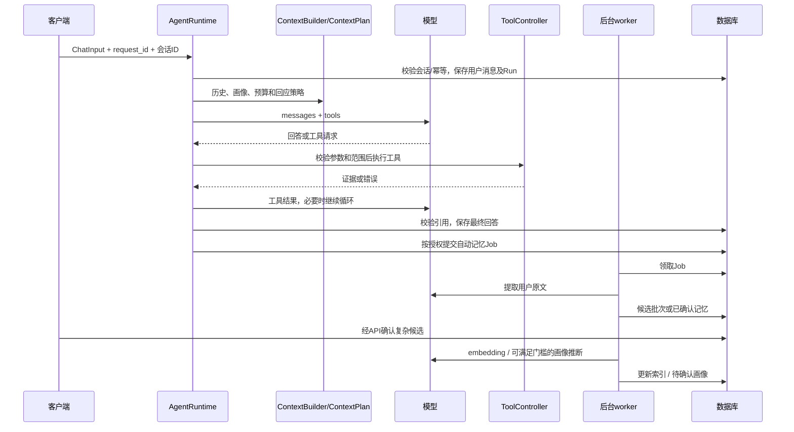

# 后端算法全流程：从用户输入到下一次回忆

> 2026-11-04，按当前源码核对。入口导航：[代码结构](backend-code-guide.md)；问题与改进：[优化审查](backend-memory-context-review.md)。以下“当前”均指实现，而非 PRD 目标。

## 1. 一轮对话同时关联两条流水线

**回答流水线**要快速结束：输入 → 上下文 → 模型/工具 → 证据复核 → 保存回复。

**记忆流水线**允许异步：原文 → 提取 → 候选审核 → 记忆版本 → 索引 → 画像。

“回答完成”“记忆已提交”“向量已准备”“画像已确认”是四个不同状态。



图省略了各次失败分支；工具内也可提出记录请求，详见下文兼容路径。

## 2. 输入与 Run 的生命周期

代码：`runtime.py::start/run/loop`。

1. 检查模型配置、会话 owner、文件范围。
2. 用 owner + request_id 查找既有 Run；复用编号但改变文本/会话则拒绝。
3. 同一会话有 RUNNING Run 时拒绝并行新 Run。
4. 新请求写入用户 Message；重试检查原消息和原 Run。
5. 保存本轮文本、跳过记忆标志、回答覆盖参数、会话授权版本和全局 epoch 快照。
6. 创建 asyncio task；超时、取消、异常转换成可见的失败回复。
7. finally 汇总 provider 调用 trace。

因此，未来 CLI 最好调用同一运行服务，而不是自己绕过授权拼 prompt。

## 3. 新版记忆如何写入

代码：`memory_v2/service.py::enqueue/process/commit/decisions`。

### 3.1 接收原文

显式记录通过 V2 records 接口。自动记录要求全局开关开启、会话 Policy 为 on、授权 revision 与本轮快照一致。原文写入 Source，任务写入 Job(kind=memory_v2)。如果携带 message_id，还检查它确实属于该会话且为相同用户原话。

**当前显式记录会进入整理流程，但复杂/敏感候选仍待确认，不是直接无条件保存全部提取结果。**

### 3.2 提取与真实性校验

模型输出受 Extraction schema 约束：fact/episode、subject、predicate、证据原文、时间状态、敏感性、画像分类等。结构不合格时最多再请求一次带 schema 的纠正提取。每条 evidence 必须是输入的逐字子串，随后保存 start/end。

这里能保证“引用文本确实存在”，不能保证模型对主体、否定、玩笑、因果的解释正确。语义真实性仍需要场景评测与规则加强。

### 3.3 哪些需要确认

满足任一条件时，当前批次进入待审核：

- mixed_narrative、多于一个候选，或原文超过 800 字符。
- private、第三方、inferred、时间 uncertain。
- 与既有 Fact 身份匹配，需要处理既有事实。

没有这些原因时，提交低风险候选；否则 Job 本身也会 SUCCEEDED，但 stage=REVIEW，批次仍未生效。无候选的输入可能形成空的 committed 批次，不应解读为新增了记忆。

### 3.4 如何识别“同一个事实”

```text
context_hash = SHA256(规范化 JSON(context)) 的前 16 位
fact_key = subject + predicate + context_hash
episode_key = subject + predicate + source_id
```

这使同一上下文的事实可以版本更新，而不同原文中的事件不会直接互相覆盖。它不是语义级实体消歧：模型换了 predicate/context 的表述，可能识别为新事实；同一事件重复讲述也可能得到不同记录。

### 3.5 确认与版本化提交

- request_id + operation + 请求摘要做幂等；expected_revision 防止过期页面覆盖。
- 提交前检查来源未撤回、当前 Fact.current_id 与候选 base_id 一致。
- inferred 候选禁止作为明确事实直接提交。
- 内容与旧版本完全相同：合并来源证据，不新增版本。
- 内容变化：旧 Memory 变 historical，新 Memory 版本号加一；依赖旧证据的画像暂停。
- 新建 MemoryMeta、Evidence；添加 index、profile_v2 后台任务。
- 本人明确自述且有 profile_category、未选择 defer_profile 时，可创建 active 自述画像。

注意：temporal_status 存在 MemoryMeta，但 Memory.status 目前只把 planned 单独映射，其余 active/completed/cancelled/uncertain 大多映射为 current；后续检索是否正确表述这些状态是待完善点。

## 4. 画像怎么形成

自述画像和推断画像是两条路径。

**自述**：“我喜欢先看结论”来自已提交记忆，可成为 communication/self_report/active。

**推断**：`infer_profiles()` 获取 owner 最近最多 100 条 current 记忆，过滤撤回和不允许用于推断的敏感内容。只有带 event_group_key 的事件证据参与独立性门槛：

```text
event_group_key = hash(subject, predicate, event_time)
至少 3 个事件组
至少 3 个来源
来源创建日期至少跨 2 天
```

满足后请求模型提出最多 3 条保守倾向，验证证据 ID、独立性门槛及生成期间 epoch 未变化，再保存 personality/inference/pending。用户接受后才 active。

门槛的局限：事件时间来自模型；“来源创建日期”不是事件真实发生日期；目前没有独立事件实体表；输入池尚未强制只取 subject=self；支持与反对证据分别需要进一步治理。详见优化审查。

## 5. 向量索引怎么生成

`main.py` worker 遇到 index Job 交给 `MemoryService.process()`，再调用 `index_job()`：

1. 读取 memory_ids 对应的非删除内容。
2. 在数据库事务之外调用 embedding。
3. 回到事务，检查对象未删除，保存向量、embedding_model、index_status=READY。
4. 标记索引 Job 完成。

这里的“索引”首先是生成向量字段。仓库中没有看到 HNSW/IVFFlat 建索引迁移，不能把 embedding READY 等同于已建立 ANN 数据库索引；线上是否手工建过索引需另查 pg_indexes。

## 6. 当前检索算法

代码：`retrieval.py::search`。

1. 按 owner、project、status 约束范围；通常仅 current/planned，历史查询另纳入 historical。
2. V2 模式先调用 filter_query，根据本轮原始用户文本过滤敏感记忆。
3. 取最近 2000 条做关键词候选：英文/数字词 + 中文二元片段，按交集数量取前 30 个非零项。
4. 有可用向量时生成查询 embedding；PostgreSQL 按 cosine_distance 排序取 30 条。该 SQL 分支的范围可超出最近 2000 条。
5. 两个排序表用 RRF 合并：每个出现位置贡献 `1 / (60 + rank)`，rank 从 1 开始。
6. 合并后取 12；超过 4 个候选时尝试 rerank，失败保留混合排序。
7. 每个首来源最多 2 条，最终最多 6 条。

当前路径没有实验分支的向量/重排绝对阈值。因此 RRF 是相对排序，不足以单独证明相关性；“候选中最好”仍可能与问题无关。

### 6.1 实验 search_v2 的差异

此处的 v2 是较早检索实验命名，与 memory_v2_enabled 不等价。

实验分支增加关键词覆盖率、向量阈值、重排分数门槛、操作性文本过滤、保守降级、去重和 diagnostics。它还有单次 Run 内缓存，缓存键包含 owner/project/query/history/内容版本摘要。

当前两条路径尚未合并：新版记忆开启会选择上面的敏感过滤混合路径，而不是此实验分支。未来应统一检索入口，把授权过滤、质量排序和诊断作为可组合阶段。

## 7. Context engine 实际由四部分组成

| 部分 | 回答什么问题 |
| --- | --- |
| ContextBuilder | 哪些历史消息可带入？ |
| ContextPlan | 哪些画像和工具结果值得带入？放多少？ |
| ToolController / Retriever | 当前请求能访问哪些材料？如何找到材料？ |
| AgentRuntime | 何时调用模型、何时再次检查预算、如何保存和核验证据？ |

### 7.1 回答档位

`effective_options()`：全局默认 + 本轮覆盖 → auto 正则判断 → 预算与轮数限制。

- auto 中出现“复盘/深入/长期规划”等偏向 deep；“我的/上次/继续”等偏向 personalized；其余 fast。
- 默认记忆预算 fast=800、personalized=1600、deep=3200；默认上限 6400。
- 默认检索调用上限 1/2/3；全局上限 3。
- 手动 0 表示不注入个人长期记忆，null 表示跟随档位。
- history_scope 有保存和传递，但未实现对应历史选择分支。

这里使用的是 UTF-8 字节数加固定余量的估算，不是供应商 tokenizer 的精确 token。中文内容会显得尤其保守。

### 7.2 历史上下文

先排除被抑制消息、部分旧删除时间之前的消息、记录回执、失败回答等。

旧路径：超过字符阈值且消息较多时，压缩旧消息，保留最近 6 条，保存 Summary。

新版路径：按当前用户消息中的敏感关键词过滤旧轮次，不复用旧摘要；按完整轮次从新到旧选取，历史预算约为 model_context_limit 的三分之一。较早但仍重要的约束可能因此丢失。

### 7.3 画像选择

取最近最多 100 条 active 画像；personality 需要本轮明确出现性格/习惯相关词；非 communication 分类要求词项交集；所有依据须存在、属于同 owner/project、状态有效且允许使用。

再按候选顺序分配最多总记忆预算的 3/8。当前并未按 pinned 排序，也没有显式多因素相关性评分。

### 7.4 预算分两层

```text
记忆预算：画像 + 个人记忆工具结果共享上限
总输入预算：模型上下文容量 - 输出预留 - 工具预留 - 额外安全余量
```

`ContextPlan.select()` 按 fact_id 或 id 去重，再按估算成本放入；`fit()` 检查消息和工具定义的总大小，超限时删除最旧完整用户轮次；无法再删则返回 413，要求分段输入。

知识库协作模式、文件、网页等也占总输入，但不都计入个人记忆预算。因此“个人记忆预算为 0”并不等于禁止使用用户主动选择的知识库或当前对话历史。

### 7.5 情绪与短期状态

回应策略由当前文本正则选择 listen/plan/troubleshoot/celebrate/explain，当前明确要求优先。

WorkingState 保存最新消息引用、主题词、情绪词和策略；每次更新覆盖原 data。读取视图在 30 分钟后将情绪标记为 needs_recheck。当前 Runtime 写入状态，却没有把这个读取视图作为连续对话规划状态重新加载；因此尚不是完整的跨轮工作记忆系统。

## 8. 工具循环与回答收尾

每轮模型调用前执行总预算 fit 和记忆 epoch 检查。模型可调用记忆、知识库、会话文件、网页等工具；参数由 Pydantic 校验，owner/project/文件/URL 范围由服务端判断。循环受 max_rounds、max_tools、run_timeout 约束。

工具结果被加入 evidence 字典，并以 tool message 给回模型。模型直接返回最终回答时：

1. 有 evidence 时先做完成状态保守检查，再请求结构化证据复核。
2. 校验引用只能来自 evidence 中的 ID，错误引用替换并告警。
3. 保存助手消息、Run 状态、trace、usage。
4. 未 skip 时按本轮授权快照提交自动记忆任务。

画像在 system 中注入，但 selected_profiles 当前没有同步加入该 evidence 字典；复核模型调用也没有走同一个 fit/完整最终 epoch 检查。这些是需要优先补齐的链路一致性问题。

## 9. 敏感使用和遗忘

当前 allowed() 主要检查私密标记/使用策略/敏感关键词；要求本轮与记忆内容有敏感词交集，再根据显式回忆词和详情要求决定是否允许。它没有真正解析人物、事件指代和话题延续关系。

删除会扩展影响到相关版本、来源、画像、摘要、工作状态等，并记录 Withdrawal/Tombstone 等，防止重新提取或导入复活。实现偏保守：部分失效范围是整个 owner，可能同时影响其他会话。

建议把“长期记忆删除后不能再进入模型”作为独立端到端验收：不仅查 Memory，还检查来源读取、旧工具结果、历史消息、摘要、画像、导出和恢复。

## 10. 一个贯穿例子

输入“最近写论文喜欢安静，今天和同学讨论后很累”：先保存原文，提取可能包括生活/学习偏好和一次事件。多项触发批次审核；你只确认偏好时，事件不会成为正式记忆。偏好提交后建立版本和证据，生成索引；若标记为自述画像，则可进入画像库。

后续问“帮我安排论文写作”：ContextBuilder 提供近期对话；ContextPlan 判断回答档位、选择相关且有效的画像；模型按需要检索记忆；预算层选入有证据的内容。后续问“解释一个数学公式”时，这条偏好不应因为存在于数据库就被强制带入。

这条链路的质量应分别验证：提取正确、确认正确、检索相关、上下文适量、回答有帮助。任何一环通过都不能替代其余环节。
