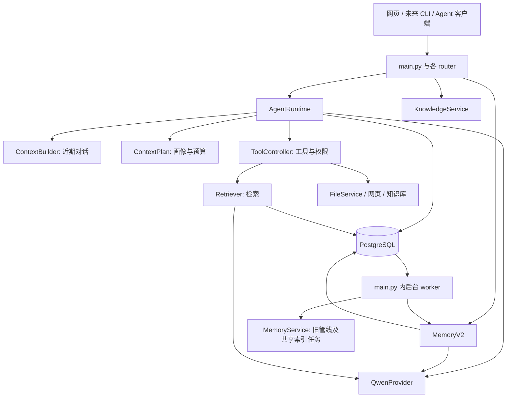
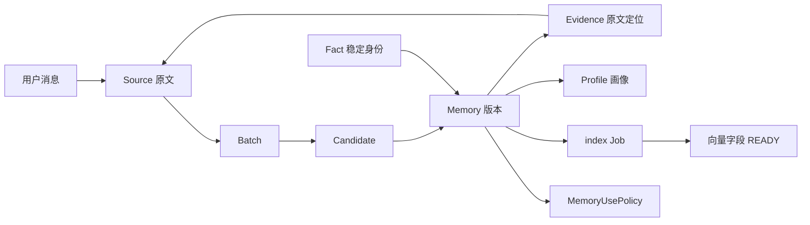

# 后端代码导读：模块、数据与调用关系

> 2026-11-05 已完成目录分层。当前源码入口见 [后端分层与模块导航](backend-layered-architecture.md)。下文保留分层前的文件名和行号，供对照算法与旧导入路径。

> 核对日期：2026-11-04。以当前工作区 Python 源码为准，包含尚未提交的修改。本文描述现状；优化建议另见 [优化审查](backend-memory-context-review.md)。本轮只写文档，不修改算法或个人数据库。

## 1. 先用五分钟认识项目

你的后端是一个 FastAPI 单体服务。它既接收聊天请求，也在同一进程中运行后台记忆任务。正式数据存于 PostgreSQL，向量字段使用 pgvector；模型调用通过百炼适配层完成。

它有五个主要职责：

1. **接收和鉴权**：确定谁在什么会话、项目中操作。
2. **执行 Agent**：准备材料，让模型调用工具，再校验并保存回答。
3. **管理记忆生命周期**：原文 → 候选 → 用户确认或低风险自动提交 → 版本化记忆 → 画像。
4. **检索与上下文组装**：决定哪些材料可以使用、哪些值得使用、能放入多少。
5. **异步处理和持久化**：完成提取、向量生成、画像推断，支持重启和数据迁移。

最值得先读的七个文件：`main.py`、`runtime.py`、`tools.py`、`memory_v2/service.py`、`retrieval.py`、`context.py`、`memory_v2/context_policy.py`。均位于 `apps/api/app/` 下。

## 2. 项目顶层目录

| 目录/文件 | 职责 | 当前学习优先级 |
| --- | --- | --- |
| `apps/api/app/` | 后端业务实现 | 最高 |
| `apps/api/tests/` | 后端行为与回归测试 | 高，配合源码读 |
| `apps/web/` | 网页客户端与服务端 API 代理 | 暂低；理解请求入口即可 |
| `scripts/` | 本机启动、诊断、检索评测、PostgreSQL 验证 | 高 |
| `infra/` | 数据库容器及环境配置 | 索引与部署时读 |
| `docs/` | 产品要求、实现记录、验证与本组导读 | 注意区分设计要求与实际实现 |
| `mermaid/` | 图表资料 | 辅助理解，以实际代码为准 |
| `tests/` | 根目录测试/辅助材料 | 当前后端主测试入口是 `apps/api/tests/` |
| `.venv/`、`node_modules/` | 安装的依赖 | 不属于业务源码 |
| `PRODUCT.md`、`DESIGN.md`、`UX-CONTRACT.md` | 产品和界面约定 | 不决定后端实际算法 |
| `package.json` | 前端工作区命令 | Python 后端另用 `.venv` 和启动脚本 |

## 3. 总体调用图

模型负责提议和生成，数据库状态、授权校验、版本冲突判断由服务端代码决定。模型说“已记住”本身不构成写入成功。

## 4. 逐文件职责：基础与执行层

以下路径均相对于 `apps/api/app/`。

| 文件 | 主要职责 | 上下游 |
| --- | --- | --- |
| `main.py` | 创建 FastAPI；鉴权和错误响应；构造服务对象；注册路由；启动后台 worker | 整个应用的组装入口 |
| `config.py` | 读取环境配置，定义模型、数据库、预算、开关默认值 | 被各服务注入；不要把默认值等同于运行环境值 |
| `db.py` | 基础 ORM 表、事务 session、所有权查询、迁移入口 | 全部持久化模块共用 |
| `schemas.py` | 通用输入结构；聊天、回答选项、旧记忆提取格式；文本校验 | API 与旧记忆服务 |
| `errors.py` | `AppError` 业务错误及响应结构 | 供路由、工具、模型适配统一报错 |
| `runtime.py` | Run 创建、工具循环、取消/超时、证据复核、引用校验、自动记忆提交 | 调用 context、tools、provider、DB |
| `tools.py` | 工具 JSON Schema、参数校验、工具路由和范围检查 | 模型工具调用 → 检索/文件/网页/知识库/写入 |
| `providers.py` | 百炼 chat、structured、embedding、rerank、search 请求与调用记录 | 业务层不直接拼供应商 HTTP 请求 |
| `tracing.py` | 调用记录上下文和 trace 展示适配 | provider 记录，runtime 汇总 |
| `views.py` | 将消息、会话、记忆、来源转换为客户端结构 | 路由输出；不负责提取算法 |
| `temporary.py` | 临时对话输入及执行 | 独立于持久个人记忆对话 |
| `web.py` | URL 检查、公共网页读取与文本整理 | `web_search` / `read_web_page` 工具 |
| `files.py` | 会话文件解析、存储、分段搜索与读取 | 与长期知识库附件是两条不同路径 |
| `migrate.py` | 命令行执行数据库迁移 | 调用 `Database.migrate()` |
| `diagnostics.py` | 配置、数据库和可选真实模型诊断 | 本机排错入口 |
| `smoke.py` | 真实链路验收脚本 | 不是线上请求入口 |
| `persistence.py` | 快照和跨进程持久化核对 | 证明重启后数据存在，不等于质量评测 |
| `__init__.py` | Python 包标识 | 无业务算法 |

## 5. 逐文件职责：记忆与 Context Engine

| 文件 | 主要职责 | 阅读提示 |
| --- | --- | --- |
| `memory.py` | 旧版提取、冲突提案、版本操作、删除、重试；仍承担共享向量索引任务 | 开启新版后仍被调用，不是废弃文件 |
| `retrieval.py` | 当前混合检索、实验 `search_v2`、核心记忆读取、遗忘消息定位 | 先读 `search()` 的分支条件 |
| `retrieval_policy.py` | 操作性文本识别、交流偏好识别、预检索触发规则 | 正则启发式，并非语义分类器 |
| `context.py` | 从消息构造近期上下文；旧路径摘要压缩；新版敏感历史过滤 | 与长期记忆检索不是一回事 |
| `context_budget.py` | 较早的 `MemoryBudget`，按 ID/版本去重、按序列化字节估算预算 | 与新版 ContextPlan 并存 |
| `memory_v2/router.py` | 会话授权、显式记录、任务/批次、候选决策、版本、画像和删除 API | 部分事务业务直接写在路由内部 |
| `memory_v2/context_router.py` | 回答设置、使用许可、跟进许可和工作状态 API | 参数存在不代表所有执行语义已接通 |
| `memory_v2/schemas.py` | 新版候选、证据、决策、修订与删除请求结构 | 描述允许进入业务层的数据 |
| `memory_v2/models.py` | 画像、批次、证据、授权、幂等、删除标记等扩展表 | 新旧记忆共用基础 Memory 表 |
| `memory_v2/service.py` | 新版写入核心：授权、提取、确认、提交、画像推断、撤回与失效 | 理解记忆机制的主文件 |
| `memory_v2/context_policy.py` | 有效回答参数、敏感许可判断、画像选择、预算、回应策略、工作状态 | 新版 context engine 的策略核心 |
| `memory_v2/portability.py` | 个人记忆/聊天资料归档、预检、合并/恢复、冲突与 ID 映射 | 不能等同于全知识库备份 |
| `memory_v2/__init__.py` | 包标识 | 无业务算法 |

## 6. 逐文件职责：知识库

知识库保存“资料、思想、关联和协作模式”；个人记忆保存“用户经历与状态”。二者在 Agent 中汇合，但数据结构和检索实现独立。

| 文件 | 职责 |
| --- | --- |
| `knowledge/router.py` | 集合、条目、版本、提案、连接、反馈、附件和备份接口 |
| `knowledge/service.py` | 条目状态与版本、证据校验、集合权限、搜索、适用协作模式选择 |
| `knowledge/models.py` | Collection、Item、Version、Membership、Proposal、Connection、Receipt、Feedback、Asset、AssetChunk |
| `knowledge/schemas.py` | 输入验证和字段边界 |
| `knowledge/patterns.py` | 从已有材料提出模式候选，进入确认流程 |
| `knowledge/parsers.py` | 长期知识文档解析 |
| `knowledge/assets.py` | 附件保存、文本分块、读取和下载 |
| `knowledge/backup.py` | 独立知识库归档与恢复 |
| `knowledge/__init__.py` | 包标识 |

当前 `KnowledgeService.search()` 是关键词匹配；它会返回语义索引未接入的提示，不能将个人记忆的向量检索能力套用到知识库。

## 7. 数据模型：不要混淆这些对象

| 对象 | 含义 | 典型关系 |
| --- | --- | --- |
| Conversation / Message | 会话和消息记录 | 一个会话有多条消息 |
| Source | 原始输入材料 | 可关联用户消息；显式 V2 记录不必生成聊天消息 |
| Batch / CandidateRow | 一次提取及其中待决条目 | Source → Batch → 多个候选 |
| Fact | 一个稳定事实身份 | `current_id` 指向当前 Memory 版本 |
| Memory | 可检索的事实/事件版本 | 保存 content、status、version、source_ids、embedding |
| MemoryMeta | 新版附加语义 | 主体、谓词、时间状态、敏感性、事件组等 |
| Evidence | 记忆到原文的证据定位 | memory_id、source_id、start/end；偏移是字符串位置 |
| Profile | 自述偏好或推断画像 | evidence_ids 指向 Memory；有 active/pending/paused 等状态 |
| Job | 后台工作项 | memory、memory_v2、index、profile_v2 等 kind |
| Run / ToolExecution | 一轮 Agent 执行及工具调用 | 不是长期记忆本身 |
| Summary / WorkingState | 摘要和工作状态 | 派生数据；不能天然当事实依据 |
| Policy / Preference | 会话授权 / 全局自动记忆开关 | 写入控制；不等于禁止读取已有记忆 |
| MemoryUsePolicy | 单条记忆使用限制 | 不同于写入授权 |
| FollowupConsent | 跟进许可记录 | 当前没有自动投递执行器 |
| Mutation | 带摘要的幂等结果 | request_id + operation + owner |
| Withdrawal / Suppression / Tombstone | 撤回、抑制复活、恢复删除保护 | 各有作用，不能简化为删除一行 |
| MemoryEpoch | 用户记忆变更序号 | 让运行中上下文检查是否过期 |
| Transfer / ImportIdentity | 迁移任务和跨归档 ID 映射 | 用于导入冲突与恢复 |

箭头表达业务依赖，不表示全部都由数据库外键强制约束；例如 Profile.evidence_ids 是 JSON 数组。

## 8. 启动及任务调度

`create_app()` 的 lifespan 初始化数据库和服务对象，按配置迁移表，然后构造 MemoryService、MemoryV2、Retriever、FileService、ToolController、AgentRuntime。

worker 在应用进程内启动：PostgreSQL advisory lock 限制一个 worker；启动时 RUNNING Job 回到 QUEUED，未完成 Run 标记中断。之后按创建时间逐个取 QUEUED 任务，分发给新版提取、新版画像或旧 MemoryService。旧 MemoryService 内部处理 index 任务。因此“后台”目前不是独立消息队列，也不是多 worker 租约系统。

## 9. 三个容易误读的开关

| 配置 | 真正作用 |
| --- | --- |
| `memory_v2_enabled` | 新版 API 可用性、写入适配、新版 ContextPlan 与敏感过滤 |
| `memory_retrieval_policy == "v2"` | 较早实验检索和部分 Runtime 逻辑；不能直接理解为新版记忆总开关 |
| 会话 Policy / 全局 Preference | 控制自动写入；已有记忆读取还要看预算和使用许可 |

`Retriever.search()` 只有在 `memory_retrieval_policy == "v2" AND NOT memory_v2_enabled` 时才转 `search_v2()`。新版记忆开启时走的是带敏感过滤的原混合检索。完整算法见 [算法文档](backend-algorithm-walkthrough.md)。

## 10. 测试与运维入口

- `test_memory_v2.py`：提取、批次、画像、版本、删除、归档和接口边界。
- `test_context_policy.py`：上下文预算、敏感约束等新版行为。
- `test_memory.py`、`test_agent.py`：旧记忆和 Agent 主链路。
- `test_retrieval_v2.py`、`test_retrieval_prd.py`：实验检索和诊断要求。
- `test_knowledge.py`：知识库；`test_acceptance_regressions.py`：已知问题回归。
- 其他 test_foundation/persistence/smoke/setup/diagnostics/windows_scripts：基础设施、启动和持久化验证。
- `scripts/start-api.ps1`、`start-db.ps1`：服务启动；`check-local.ps1`：本机诊断。
- `scripts/evaluate_retrieval.py`：现有 30 查询检索评测，真实模式调用云端；SQLite 隔离环境不代表 PostgreSQL 性能。
- `scripts/verify_v2_postgres.py`：独立 PostgreSQL schema 的记忆机制验证，可选择真实提取。
- `setup_local.py` / `setup-local.ps1`：初始化配置；`verify-live.ps1` / `verify-persistence.ps1`：真实基础链路和跨进程核对。

推荐读法：先读本文，再读算法文档，然后挑一个失败场景去看优化审查。单元测试数量不能替代真实多轮质量评测。

## 11. 源码跳转索引

以下按当前源码自动生成类/函数入口，行号便于在编辑器定位。文件链接可直接打开；行号随后续改动可能变化。业务解释见前文，算法步骤见第二份文档。

### [config.py](../apps/api/app/config.py)

- `Settings`：第 10 行。
  方法：`storage`（58）。

### [context.py](../apps/api/app/context.py)

- `ContextBuilder`：第 7 行。
  方法：`build`（11）。

### [context_budget.py](../apps/api/app/context_budget.py)

- `size`：第 4 行。
- `MemoryBudget`：第 8 行。
  方法：`select`（12）。

### [db.py](../apps/api/app/db.py)

- `uid`：第 25 行。
- `now`：第 33 行。
- `Base`：第 42 行。
- `Entity`：第 46 行。
- `Conversation`：第 52 行。
- `Message`：第 59 行。
- `Preference`：第 67 行。
- `Source`：第 74 行。
- `Fact`：第 84 行。
- `Memory`：第 92 行。
- `Proposal`：第 113 行。
- `Job`：第 126 行。
- `Suppression`：第 140 行。
- `Run`：第 146 行。
- `ToolExecution`：第 157 行。
- `Summary`：第 168 行。
- `File`：第 176 行。
- `Chunk`：第 185 行。
- `Database`：第 195 行。
  方法：`migrate`（209）；`session`（234）。
- `owned`：第 240 行。
- `preference`：第 248 行。

### [diagnostics.py](../apps/api/app/diagnostics.py)

- `check`：第 18 行。
- `configuration_checks`：第 22 行。
- `database_checks`：第 98 行。
- `cloud_checks`：第 164 行。
- `diagnose`：第 269 行。
- `main`：第 295 行。

### [errors.py](../apps/api/app/errors.py)

- `AppError`：第 4 行。
  方法：`body`（10）。

### [files.py](../apps/api/app/files.py)

- `parse_file`：第 15 行。
- `FileService`：第 74 行。
  方法：`upload`（78）；`list`（107）；`search`（115）；`read`（140）；`read_sections`（153）。

### [knowledge/assets.py](../apps/api/app/knowledge/assets.py)

- `AssetService`：第 9 行。
  方法：`upload`（14）；`read`（53）；`download`（69）。

### [knowledge/backup.py](../apps/api/app/knowledge/backup.py)

- `export_bundle`：第 24 行。
- `restore_bundle`：第 48 行。

### [knowledge/models.py](../apps/api/app/knowledge/models.py)

- `Collection`：第 7 行。
- `Item`：第 14 行。
- `Version`：第 22 行。
- `Membership`：第 32 行。
- `Proposal`：第 41 行。
- `Connection`：第 49 行。
- `Receipt`：第 59 行。
- `Feedback`：第 67 行。
- `Asset`：第 74 行。
- `AssetChunk`：第 83 行。

### [knowledge/parsers.py](../apps/api/app/knowledge/parsers.py)

- `parse_document`：第 10 行。

### [knowledge/patterns.py](../apps/api/app/knowledge/patterns.py)

- `review_patterns`：第 12 行。

### [knowledge/router.py](../apps/api/app/knowledge/router.py)

- `router`：第 19 行。

### [knowledge/schemas.py](../apps/api/app/knowledge/schemas.py)

- `CollectionInput`：第 21 行。
- `ItemInput`：第 27 行。
  方法：`safe`（38）；`bounded`（43）。
- `RevisionInput`：第 62 行。
- `ConnectionInput`：第 66 行。
  方法：`safe`（75）。
- `SearchInput`：第 79 行。
- `DecisionInput`：第 85 行。
- `DeleteInput`：第 89 行。
- `FeedbackInput`：第 93 行。

### [knowledge/service.py](../apps/api/app/knowledge/service.py)

- `KnowledgeService`：第 24 行。
  方法：`transact`（28）；`collections`（42）；`create_collection`（49）；`scope`（58）；`active`（62）；`validate_evidence`（68）；`view`（75）；`write`（90）；`create`（124）；`decide`（149）；`get`（164）；`invalidate`（168）；`revise`（179）；`history`（187）；`connect`（197）；`connections`（212）；`search`（235）；`applicable_patterns`（294）；`delete`（332）；`feedback`（389）。

### [main.py](../apps/api/app/main.py)

- `Decision`：第 38 行。
- `Deletion`：第 42 行。
- `MemoryPolicy`：第 47 行。
- `EditCandidate`：第 51 行。
- `NewConversation`：第 55 行。
- `create_app`：第 59 行。

### [memory.py](../apps/api/app/memory.py)

- `normalize`：第 57 行。
- `claim_digest`：第 61 行。
- `hour_values`：第 65 行。
- `MemoryService`：第 86 行。
  方法：`enqueue`（90）；`process`（189）；`resolve`（292）；`commit_candidates`（376）；`receipt`（550）；`index_job`（587）；`fail`（636）；`revise`（653）；`delete`（705）；`decide`（779）；`edit_proposal`（823）；`retry`（850）。

### [memory_v2/context_policy.py](../apps/api/app/memory_v2/context_policy.py)

- `token_estimate`：第 20 行。
- `effective_options`：第 26 行。
- `allowed`：第 56 行。
- `filter_query`：第 80 行。
- `response_strategy`：第 97 行。
- `ContextPlan`：第 111 行。
  方法：`select`（126）；`profiles`（144）；`fit`（181）。
- `update_working_state`：第 196 行。
- `working_state_view`：第 219 行。

### [memory_v2/context_router.py](../apps/api/app/memory_v2/context_router.py)

- `SettingsChange`：第 16 行。
- `UsePolicyChange`：第 20 行。
- `ConsentChange`：第 27 行。
  方法：`window`（34）。
- `router`：第 46 行。

### [memory_v2/models.py](../apps/api/app/memory_v2/models.py)

- `Policy`：第 7 行。
- `Batch`：第 15 行。
- `CandidateRow`：第 24 行。
- `Profile`：第 33 行。
- `MemoryMeta`：第 45 行。
- `Evidence`：第 53 行。
- `Withdrawal`：第 61 行。
- `Tombstone`：第 67 行。
- `Mutation`：第 73 行。
- `Transfer`：第 82 行。
- `MemoryEpoch`：第 90 行。
- `ImportIdentity`：第 96 行。
- `ResponseSettings`：第 103 行。
- `MemoryUsePolicy`：第 110 行。
- `FollowupConsent`：第 121 行。
- `WorkingState`：第 129 行。

### [memory_v2/portability.py](../apps/api/app/memory_v2/portability.py)

- `export_archive`：第 52 行。
- `validate_archive`：第 93 行。
- `Portability`：第 166 行。
  方法：`path`（170）；`create`（176）；`read`（212）；`conflicts`（238）；`restore`（259）。

### [memory_v2/router.py](../apps/api/app/memory_v2/router.py)

- `router`：第 14 行。

### [memory_v2/schemas.py](../apps/api/app/memory_v2/schemas.py)

- `Change`：第 8 行。
- `PolicyChange`：第 13 行。
- `Record`：第 17 行。
- `Extracted`：第 25 行。
- `Extraction`：第 43 行。
- `Decision`：第 48 行。
- `Decisions`：第 55 行。
  方法：`unique_ids`（59）。
- `Edit`：第 65 行。
- `Revision`：第 69 行。
- `ProfileDecision`：第 74 行。
- `ProfileChange`：第 78 行。
- `Target`：第 83 行。
- `Deletion`：第 89 行。

### [memory_v2/service.py](../apps/api/app/memory_v2/service.py)

- `check_revision`：第 50 行。
- `withdrawn`：第 55 行。
- `invalidate`：第 59 行。
- `memory_epoch`：第 70 行。
- `serialize`：第 79 行。
- `claim_key`：第 87 行。
- `MemoryV2`：第 96 行。
  方法：`mutation`（100）；`policy`（128）；`enqueue`（149）；`valid_job`（214）；`process`（233）；`commit`（322）；`decisions`（434）；`infer_profiles`（464）；`process_profile`（554）；`pause_profiles`（578）；`delete`（583）。

### [persistence.py](../apps/api/app/persistence.py)

- `validate_owner`：第 32 行。
- `snapshot`：第 37 行。
- `validate_manifest`：第 72 行。
- `verify_snapshot`：第 90 行。
- `main`：第 107 行。

### [providers.py](../apps/api/app/providers.py)

- `QwenProvider`：第 11 行。
  方法：`last_usage`（18）；`last_usage`（22）；`require`（26）；`request`（32）；`chat`（91）；`structured`（113）；`embed`（126）；`rerank`（155）；`search`（184）。

### [retrieval.py](../apps/api/app/retrieval.py)

- `terms`：第 18 行。
- `similarity`：第 24 行。
- `result`：第 31 行。
- `Retriever`：第 43 行。
  方法：`search`（47）；`core`（115）；`search_v2`（128）；`suppressed_messages`（295）。

### [retrieval_policy.py](../apps/api/app/retrieval_policy.py)

- `operation_only`：第 6 行。
- `communication_preference`：第 14 行。
- `needs_memory`：第 23 行。

### [runtime.py](../apps/api/app/runtime.py)

- `guard_missing_completion`：第 49 行。
- `AgentRuntime`：第 66 行。
  方法：`prior_urls`（80）；`start`（106）；`update`（195）；`cancel`（202）；`run`（210）；`loop`（255）；`finish_error`（730）。

### [schemas.py](../apps/api/app/schemas.py)

- `validate_text`：第 9 行。
- `Strict`：第 21 行。
- `ResponseOptions`：第 25 行。
- `ChatInput`：第 32 行。
  方法：`safe`（44）。
- `RecordInput`：第 48 行。
- `Revision`：第 54 行。
- `Candidate`：第 59 行。
- `Extraction`：第 71 行。

### [smoke.py](../apps/api/app/smoke.py)

- `memory_checkpoint`：第 33 行。
- `verify`：第 65 行。

### [temporary.py](../apps/api/app/temporary.py)

- `Turn`：第 16 行。
- `TemporaryInput`：第 21 行。
- `temporary_chat`：第 25 行。

### [tools.py](../apps/api/app/tools.py)

- `Query`：第 11 行。
- `Identifier`：第 15 行。
- `WebURL`：第 19 行。
- `FileQuery`：第 23 行。
- `FileRead`：第 27 行。
- `NoArguments`：第 31 行。
- `tool_schemas`：第 58 行。
- `ToolController`：第 72 行。
  方法：`execute`（82）。

### [tracing.py](../apps/api/app/tracing.py)

- `trace_view`：第 12 行。
- `clock`：第 56 行。

### [views.py](../apps/api/app/views.py)

- `message_view`：第 4 行。
- `conversation_view`：第 32 行。
- `memory_view`：第 47 行。
- `evidence_view`：第 76 行。

### [web.py](../apps/api/app/web.py)

- `public_url`：第 14 行。
- `fetch_page`：第 29 行。
- `read_page`：第 79 行。
