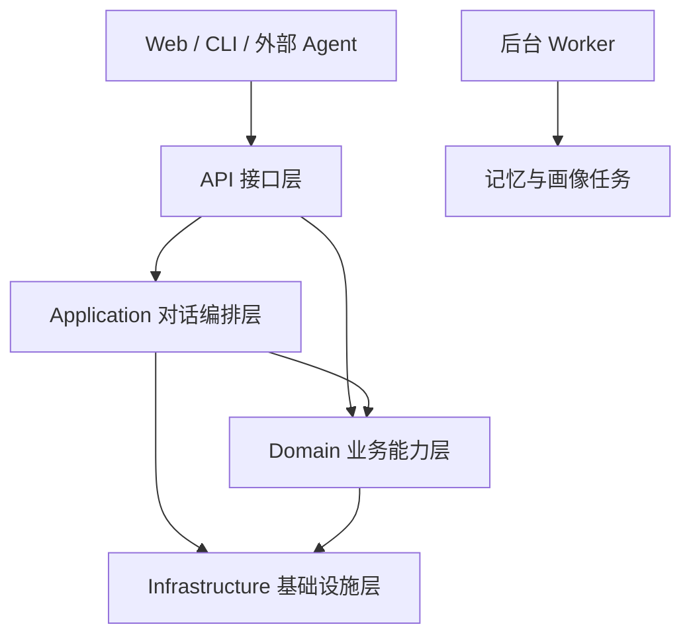

# 后端分层与模块导航

2026-11-05。业务实现位于 `apps/api/app/` 下的四个目录。`app.main:app` 仍是现有启动入口，它指向 `app.api.server`。

后台 Worker 由 API 启动，接收已装配的业务服务，按任务类型调度。管理类 API 可以直接调用业务服务，例如查看画像或确认记忆。

| 层 | 目录与入口 | 职责 |
| --- | --- | --- |
| API | [`api/`](../apps/api/app/api)，从 [`server.py`](../apps/api/app/api/server.py) 开始 | FastAPI 装配、鉴权、请求/响应模型。`memory_routes` 管理记忆、候选和画像，`context_routes` 管理回答设置与使用许可，`knowledge_routes` 管理知识库。 |
| Application | [`application/`](../apps/api/app/application)，从 [`runtime.py`](../apps/api/app/application/runtime.py) 开始 | Agent 一轮对话、工具分发、回答复核、临时对话。`context/history.py` 选择历史，`context/plan.py` 选择画像并管理本轮预算，`context/budget.py` 保留旧路径预算。 |
| Domain | [`domain/`](../apps/api/app/domain) | `memory/` 管理记忆写入、证据、版本、授权、删除和归档，`profile.py` 管理画像推断任务与证据失效，`retrieval/` 管理检索策略和排序，`knowledge/` 管理知识库，`files.py` 管理会话文件。 |
| Infrastructure | [`infrastructure/`](../apps/api/app/infrastructure) | `db.py` 管理数据库连接与基础模型，`providers.py` 实现百炼调用，`worker.py` 调度后台任务，`config.py` 加载配置，`tracing.py` 记录调用，`web.py` 读取网页。 |

根目录的 `errors.py` 和 `validation.py` 是共享错误与输入校验。`migrate.py`、`diagnostics.py`、`smoke.py` 和 `persistence.py` 保留为运维命令入口。其他旧路径中的兼容模块指向新目录中的同一 Python 模块，以继续支持既有脚本和测试。

## 按功能找代码

| 想改什么 | 从哪里读 | 接着读 |
| --- | --- | --- |
| 调整候选提取、确认、版本更新 | [`domain/memory/service.py`](../apps/api/app/domain/memory/service.py) | `domain/memory/schemas.py`、`api/memory_routes.py` |
| 调整画像推断与证据门槛 | [`domain/profile.py`](../apps/api/app/domain/profile.py) | `domain/memory/models.py`、`api/memory_routes.py` |
| 调整敏感记忆使用权限 | [`domain/memory/access.py`](../apps/api/app/domain/memory/access.py) | `application/tools.py`、`api/context_routes.py` |
| 优化召回、阈值、排序 | [`domain/retrieval/service.py`](../apps/api/app/domain/retrieval/service.py) | `domain/retrieval/policy.py`、`infrastructure/db.py` |
| 调整历史窗口、画像选择和上下文预算 | [`application/context/plan.py`](../apps/api/app/application/context/plan.py) | `application/context/history.py`、`application/runtime.py` |
| 调整任务调度、向量写入 | [`infrastructure/worker.py`](../apps/api/app/infrastructure/worker.py) | `domain/memory/legacy.py` 的 `index_job()` |

画像推断由 `ProfileService` 执行。自述画像的创建仍在记忆提交事务内，画像确认与修订仍在记忆路由的事务中。当前分层保留这些事务边界，方便之后按功能逐步迁移。业务服务目前直接使用 SQLAlchemy 数据模型和 session。

旧的模块名和行号在 [代码导读](backend-code-guide.md) 中作为分层前的阅读资料。算法流程和改进建议见 [算法流程](backend-algorithm-walkthrough.md) 与 [优化审查](backend-memory-context-review.md)。
